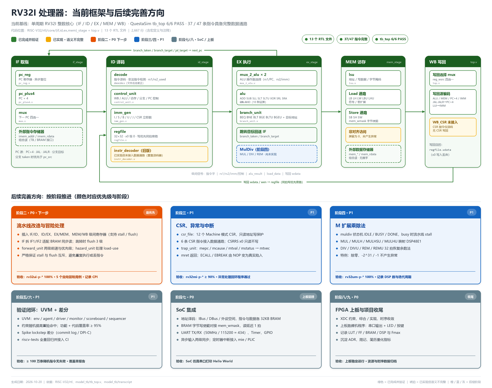

# RV32I 处理器：已完成功能记录与后续完善方向（v1 · 单周期基线）

> **基线日期**：2026-10-20  
> **代码位置**：`RISC-V32/rtl`、`RISC-V32/model_tb`  
> **仿真器**：QuestaSim 2024  
> **当前结论**：阶段一（单周期）已具备可运行基线 —— **37 / 47 条指令具备完整数据通路**，`tb_top` **6/6 PASS**；尚未进入流水线改造。

---

## 目录

- [0. 一页速览](#0-一页速览)
- [1. 框架图与色标](#1-框架图与色标)
- [2. 已完成的功能代码](#2-已完成的功能代码)
  - [2.1 顶层集成与数据流](#21-顶层集成与数据流)
  - [2.2 模块清单](#22-模块清单)
  - [2.3 各模块实现要点](#23-各模块实现要点)
  - [2.4 指令支持矩阵（47 条）](#24-指令支持矩阵47-条)
  - [2.5 关键控制编码](#25-关键控制编码)
- [3. 验证现状](#3-验证现状)
- [4. 已知问题与技术债](#4-已知问题与技术债)
- [5. 后续完善方向](#5-后续完善方向)
- [6. 代码索引与阅读顺序](#6-代码索引与阅读顺序)
- [7. 维护约定与变更记录](#7-维护约定与变更记录)

---

## 0. 一页速览

| 维度 | 现状 |
|---|---|
| 微架构 | **单周期**；RTL 按 IF / ID / EX / MEM / WB 五个逻辑阶段分目录组织，但**没有级间寄存器** |
| 指令集 | RV32I 子集：37 条完整数据通路；FENCE / FENCE.I / ECALL / EBREAK 仅译码；6 条 Zicsr 仅译码 |
| 顶层接口 | 哈佛结构，指令/数据存储器外置；**组合读、无 valid/ready 握手** |
| 写回 | ALU / MEM / PC+4 / IMM 四选一；`WB_CSR` 已预留但未接入 |
| 复位 | `pc_reg` 异步低有效复位；`regfile` 无复位（x0 恒 0） |
| 验证 | `tb_top` 覆盖 ADD/ADDI/LW/SW/BEQ/JAL/JALR，**6/6 PASS**，仿真 216 ns |
| 代码规模 | **13 个 RTL 文件，2,667 行**（含宏文件与注释） |
| Git | 仓库已有 3 次 `Initial commit`，但 `rtl/`、`doc/`、`model_tb/` **仍为未跟踪状态** |
| 所处阶段 | 阶段一基本完成（37/47）；**阶段二（流水线 + 冒险）尚未开始** |

**一句话判断**：现在是一个“功能正确性已被小规模定向用例证明”的单周期 RV32I 子集核，足以作为流水线改造的功能基线；但离 `riscv-tests` 全通过、CSR/异常、M 扩展、SoC 与上板还差四个阶段。

**最紧急的三件事**：

1. 把当前 RTL 基线提交进 Git（现在随时可能丢失）。
2. 合并重复译码器，`deocde.v` 更名为 `decode.v`。
3. 启动阶段二：级间寄存器 → 前递 → 冒险检测 → 3 级 flush。

---

## 1. 框架图与色标



> 矢量可编辑版：[riscv32_架构框架与完善方向.svg](../diagrams/archive/single_cycle_架构框架.svg)

**色标定义**（全文与图中一致）：

| 标记 | 颜色 | 含义 |
|---|---|---|
| ✅ | 🟩 绿色实线 | 已实现、已接入 `top.v`、并通过当前仿真 |
| ⚠️ | 🟨 琥珀色 | 已实现或已译码，但**未接入数据通路**，或语义不完整（当前等效 NOP） |
| 🟧 | 橙色 | **阶段二 · P0 · 下一步**：流水线与冒险处理 |
| 🟦 | 蓝色 | **阶段三/四 · P1**：CSR/异常、M 扩展乘除法 |
| ⬜ | 灰色 | **阶段五~九**：UVM、差分验证、SoC、FPGA 上板、收尾 |

**看图要点**：

- 上方五个深绿色标题栏是当前 `top.v` 的逻辑分段；框内白底模块均已实例化。
- 两条绿色回环：上方是**分支/跳转目标回送 PC**，下方是 **WB 写回 regfile**。
- 琥珀色块是“代码存在但没接上”的部分：`instr_decoder`、`WB_CSR`、非对齐访问策略。
- 蓝色虚线块 `MulDiv` 是阶段四的预留位置；下方六张卡片给出阶段、优先级与验收标准。

---

## 2. 已完成的功能代码

### 2.1 顶层集成与数据流

`top.v` 是当前唯一的集成点，按**单周期**方式把下列模块组合起来：

```
pc_reg ──► imem_addr ──► (外部指令存储器) ──► imem_rdata
   ▲                                              │
   │                                              ▼
 next_pc ◄── PC mux ◄── branch/jal/jalr 目标   decode ──► control_unit
                                                   │            │
                                                   ▼            ▼
                                                regfile ◄── WB mux ◄── ALU / LSU / PC+4 / IMM
                                                   │            ▲
                                                   └──► ALU ────┘
                                                        │
                                                        ▼
                                                       LSU ──► (外部数据存储器)
```

**一个时钟周期内完成**：取指 → 译码 → 读寄存器 → 执行 → 访存 → 写回。因此当前 **CPI = 1**（无停顿），但也意味着关键路径贯穿全部五段，频率不会高。

**PC 选择逻辑**（`rtl/core/top.v:72-76`）：

```verilog
// 分支优先于控制单元给出的顺序/JAL/JALR 选择
assign pc_src_effective = branch_taken ? 2'd3 : pc_src_control;
assign jal_target       = pc + immediate;
assign jalr_target      = {alu_result[`XLEN-1:1], 1'b0};  // 清 bit0
```

`mux.v` 按 `pc_src_effective` 四选一：

| `pc_src` | 来源 | 使用场景 |
|---|---|---|
| `2'd0` | `pc + 4` | 顺序执行 |
| `2'd1` | `jalr_target` | JALR |
| `2'd2` | `jal_target` | JAL |
| `2'd3` | `branch_target` | 条件分支 taken（优先级最高） |

**写回选择**（`rtl/core/top.v:198-206`）：

```verilog
always @(*) begin
    case (reg_wsrc)
        `WB_ALU: wb_data = alu_result;   // R/I 型算术、AUIPC、JALR 地址计算
        `WB_MEM: wb_data = load_data;    // LB/LH/LW/LBU/LHU
        `WB_PC4: wb_data = pc_plus_4;    // JAL/JALR 链接值
        `WB_IMM: wb_data = immediate;    // LUI
        default: wb_data = {`XLEN{1'b0}};
    endcase
end
```

**顶层端口**（`rtl/core/top.v:6-21`）：

| 端口 | 方向 | 位宽 | 说明 |
|---|---|---|---|
| `clk` / `rst_n` | in | 1 | 时钟、异步低有效复位 |
| `imem_addr` | out | 32 | 取指地址（= PC） |
| `imem_rdata` | in | 32 | 指令字，组合读 |
| `mem_addr` / `mem_wdata` | out | 32 | 数据地址、写数据 |
| `mem_wmask` | out | 4 | 字节写掩码 |
| `mem_ren` / `mem_wen` | out | 1 | 读/写使能 |
| `mem_rdata` | in | 32 | 读数据，组合读 |
| `illegal_instr` | out | 1 | 当前指令非法（仅指示，无 trap） |

> ⚠️ `illegal_instr` 只用于门控写回与写存储器（`top.v:137`、`top.v:186`），**不会停止 PC，也不会进入异常**。非法指令当前表现为“无副作用地跳过”。

---

### 2.2 模块清单

| 阶段 | 模块 | 文件 | 行数 | 完成功能 | 状态 |
|---|---|---|---:|---|---|
| — | 宏定义 | `rtl/riscv_def.vh` | 513 | XLEN、opcode、funct3/7、ALU/分支/CSR/WB/流水线控制编码 | ✅ |
| IF | `pc_reg` | `rtl/core/if_stage/pc_reg.v` | 18 | PC 寄存器，异步复位到 0 | ✅ |
| IF | `pc_plus4` | `rtl/core/if_stage/pc_plus4.v` | 7 | PC + 4 | ✅ |
| IF | `mux` | `rtl/core/if_stage/mux.v` | 16 | 下一 PC 四选一（参数化位宽） | ✅ |
| ID | `decode` | `rtl/core/id_stage/deocde.v` | 418 | opcode/funct 译码、非法指令检测、`rs1_used/rs2_used` | ✅ |
| ID | `control_unit` | `rtl/core/id_stage/control_unit.v` | 779 | WB / ALU / 立即数 / 访存 / 分支 / PC 控制 | ✅ |
| ID | `imm_gen` | `rtl/core/id_stage/imm_gen.v` | 21 | I/S/B/U/J/CSR 六类立即数 | ✅ |
| ID | `regfile` | `rtl/core/id_stage/regfile.v` | 26 | 32×32、x0 恒 0、同拍写优先旁路 | ✅ |
| ID | `instr_decoder` | `rtl/core/id_stage/instr_decoder.v` | 327 | 另一套译码器（旧版） | ⚠️ 未接入 |
| EX | `mux_2_alu` | `rtl/core/ex_stage/mux_2_alu.v` | 25 | ALU 两操作数四选一 | ✅ |
| EX | `alu` | `rtl/core/ex_stage/alu.v` | 33 | ADD/SUB/SLL/SLT/SLTU/XOR/SRL/SRA/OR/AND | ✅ |
| EX | `branch_unit` | `rtl/core/ex_stage/branch_unit.v` | 45 | 6 种条件分支比较 + `pc + imm` 目标 | ✅ |
| MEM | `lsu` | `rtl/core/mem_stage/lsu.v` | 228 | 字节/半字/字读写、字节掩码、符号/零扩展 | ✅ |
| WB | 写回 mux | `rtl/core/top.v:198-206` | — | `reg_wsrc` 四选一 | ✅ |
| — | CSR / trap | 未创建 | — | `csr_file`、`trap_unit`、`mret` | ⬜ |
| — | 流水线寄存器 | 未创建 | — | IF/ID、ID/EX、EX/MEM、MEM/WB | ⬜ |
| — | 冒险/前递 | 未创建 | — | `hazard_unit`、`forward_unit` | ⬜ |
| **合计** | **13 个文件** | | **2,667** | | |

---

### 2.3 各模块实现要点

#### 2.3.1 IF 取指

- `pc_reg.v`：`always @(posedge clk or negedge rst_n)`，复位值 `32'd0`。
- `pc_plus4.v`：`assign next_pc = pc + 32'd4`。
- `mux.v`：参数 `ADDR_WIDTH=32`，`pc_src` 四选一；早期版本位宽错误已修正。
- 取指地址直接等于 PC：`assign imem_addr = pc;`（`top.v:68`），指令存储器在顶层之外组合读。

> **流水线改造注意**：BRAM 是同步读，取指需要拆成 IF1（发地址）/ IF2（收指令）两拍；分支 flush 因此是 **3 级**而非 2 级。

#### 2.3.2 ID 译码

**`decode`**（`deocde.v`）负责“这条指令是什么”：

- 按 `opcode` 分派到 LUI/AUIPC/JAL/JALR/BRANCH/LOAD/STORE/OP-IMM/OP/MISC-MEM/SYSTEM。
- 二级译码：`funct3` 与 `funct7` 组合判定具体指令，例如 `OP` 的 `funct3=000` 配合 `funct7=0100000` 才是 SUB。
- 输出内部 `instruction_id`（6 bit）与 `instruction_type`（I/S/B/U/J/R/CSR/NONE）。
- 输出 `rs1_used` / `rs2_used`，当前只用于占位，**留给未来的 hazard unit**。
- 非法编码统一落到 `INST_INVALID`，并清空 `instruction_type` 与 used 标志。

```verilog
assign illegal_instr = (instruction_id == `INST_INVALID);   // deocde.v:33
```

**`control_unit`** 负责“这条指令怎么执行”：

- 先把所有输出赋默认值（不写回、不访存、不分支、`PC+4`），避免 latch：
  ```verilog
  wb_en = 1'b0;  reg_wsrc = `WB_ALU;
  ALUsrc_1 = `ALUSRC1_RS1;  ALUsrc_2 = `ALUSRC2_RS2;  ALU_op = `ALU_ADD;
  mem_rd_en = 1'b0;  mem_wr_en = 1'b0;  mem_size = `MEM_WORD;
  branch_en = 1'b0;  branch_type = `BR_BEQ;  pc_src = `PC_NEXT;
  ```
- 再用 `case (instr_id)` 覆盖 37 条已实现指令的控制信号。
- 未覆盖的 ID（FENCE/FENCE.I/ECALL/EBREAK/CSR）落入 `default`，**保持无副作用**。

**`imm_gen`** 六类立即数（`imm_gen.v:11-17`）：

| 类型 | 拼接方式 | 使用者 |
|---|---|---|
| I | `{{20{instr[31]}}, instr[31:20]}` | ADDI/LW/JALR… |
| S | `{{20{instr[31]}}, instr[31:25], instr[11:7]}` | SB/SH/SW |
| B | `{{19{instr[31]}}, instr[31], instr[7], instr[30:25], instr[11:8], 1'b0}` | 条件分支 |
| U | `{instr[31:12], 12'b0}` | LUI/AUIPC |
| J | `{{11{instr[31]}}, instr[31], instr[19:12], instr[20], instr[30:21], 1'b0}` | JAL |
| CSR | `{27'b0, instr[19:15]}` | CSRRWI/SI/CI（仅译码） |

**`regfile`**：

```verilog
always @(posedge clk)
    if (wen && waddr != 5'd0) rf[waddr] <= wdata;

assign rd1 = (rs1 == 5'd0) ? 32'd0 :
             (wen && (rs1 == waddr)) ? wdata : rf[rs1];
assign rd2 = (rs2 == 5'd0) ? 32'd0 :
             (wen && (rs2 == waddr)) ? wdata : rf[rs2];
```

- x0 写入丢弃、读出恒 0。
- 同拍写优先旁路，缓解单周期内“写后读”的结构冒险。
- **无复位**：未写过的寄存器在仿真开始时为 `X`；`tb_top` 通过先写后读规避。

#### 2.3.3 EX 执行

- `mux_2_alu`：`alusrc` 四选一，实例化两次分别选 `operand_a`（`rs1_data`/`pc`）与 `operand_b`（`rs2_data`/`immediate`）。
- `alu`：10 种运算，移位量取 `operand_b[4:0]`；`SLT/SLTU` 分别做有符号/无符号比较；默认输出 0。
- `branch_unit`：

```verilog
assign branch_target = pc + imm;
if (branch_en) case (branch_type)
    `BR_BEQ:  branch_taken = (rs1_data == rs2_data);
    `BR_BNE:  branch_taken = (rs1_data != rs2_data);
    `BR_BLT:  branch_taken = ($signed(rs1_data) <  $signed(rs2_data));
    `BR_BGE:  branch_taken = ($signed(rs1_data) >= $signed(rs2_data));
    `BR_BLTU: branch_taken = (rs1_data <  rs2_data);
    `BR_BGEU: branch_taken = (rs1_data >= rs2_data);
endcase
```

- JAL/JALR 的链接值（PC+4）由写回 mux 的 `WB_PC4` 提供，不单独产生目标地址。

#### 2.3.4 MEM 访存

`lsu.v` 完成三件事：

1. **地址与请求**：`mem_addr = addr`（ALU 结果），`mem_ren/mem_wen` 直通控制信号。
2. **写数据对齐 + 字节掩码**：按 `addr[1:0]` 把 `rs2_data` 挪到正确字节车道。

   | 访问 | `addr[1:0]` | `mem_wmask` | 数据位置 |
   |---|---|---|---|
   | SB | 00/01/10/11 | 0001/0010/0100/1000 | `rs2_data[7:0]` 对应字节 |
   | SH | 00/10 | 0011/1100 | `rs2_data[15:0]` |
   | SW | 00 | 1111 | `rs2_data` |
   | 非对齐 SH/SW | 其他 | **0000** | 写入被丢弃 |

3. **读数据选择 + 扩展**：按 `addr[1:0]` 从 `mem_rdata` 选字节/半字，按 `mem_unsigned` 做符号或零扩展；`LW` 仅接受 `addr[1:0]==00`。

> ⚠️ 非对齐访问当前**静默屏蔽为 0 / 丢弃写**，既不拆分访问也不产生异常，属于 RV32I 语义缺口。

#### 2.3.5 WB 写回

- `reg_wsrc` 四选一：`ALU / MEM / PC+4 / IMM`。
- 写使能：`wb_en && !illegal_instr`（`top.v:137`）。
- `WB_CSR` 宏已定义，但**没有 CSR 数据源，也没有 CSR 寄存器堆**。

---

### 2.4 指令支持矩阵（47 条）

> “完整”= 译码 + 控制 + 数据通路均已实现（不表示已被 `tb_top` 覆盖）。  
> “仅译码”= `decode` 能识别，但 `control_unit` 落入 default，当前**等效 NOP**。

#### R 型（10 条）— 全部完整 ✅

| 指令 | 功能 | 实现 |
|---|---|---|
| ADD | `rd = rs1 + rs2` | `ALU_ADD` + `WB_ALU` |
| SUB | `rd = rs1 - rs2` | `ALU_SUB` |
| SLL | `rd = rs1 << rs2[4:0]` | `ALU_SLL` |
| SLT | 有符号小于 | `ALU_SLT` |
| SLTU | 无符号小于 | `ALU_SLTU` |
| XOR | 按位异或 | `ALU_XOR` |
| SRL | 逻辑右移 | `ALU_SRL` |
| SRA | 算术右移 | `ALU_SRA` |
| OR | 按位或 | `ALU_OR` |
| AND | 按位与 | `ALU_AND` |

#### I 型算术（9 条）— 全部完整 ✅

| 指令 | 功能 | 实现 |
|---|---|---|
| ADDI | `rd = rs1 + imm` | `ALU_ADD`，`ALUSRC2_IMM` |
| SLTI | 有符号比较立即数 | `ALU_SLT` |
| SLTIU | 无符号比较（立即数先符号扩展） | `ALU_SLTU` |
| XORI | 异或立即数 | `ALU_XOR` |
| ORI | 或立即数 | `ALU_OR` |
| ANDI | 与立即数 | `ALU_AND` |
| SLLI | 立即数左移 | `ALU_SLL`，`funct7` 校验 |
| SRLI | 逻辑右移 | `ALU_SRL` |
| SRAI | 算术右移 | `ALU_SRA` |

#### Load（5 条）— 全部完整 ✅

| 指令 | 功能 | 实现 |
|---|---|---|
| LB | 字节符号扩展 | `MEM_BYTE` + `mem_unsigned=0` |
| LH | 半字符号扩展 | `MEM_HALF` + 有符号 |
| LW | 字 | `MEM_WORD` |
| LBU | 字节零扩展 | `MEM_BYTE` + `mem_unsigned=1` |
| LHU | 半字零扩展 | `MEM_HALF` + 无符号 |

#### Store（3 条）— 全部完整 ✅

| 指令 | 功能 | 实现 |
|---|---|---|
| SB | 存字节 | `mem_wmask` 单字节 |
| SH | 存半字 | `mem_wmask` 两字节 |
| SW | 存字 | `mem_wmask=1111`（仅对齐） |

#### 条件分支（6 条）— 全部完整 ✅

| 指令 | 条件 | 实现 |
|---|---|---|
| BEQ | `rs1 == rs2` | `BR_BEQ` |
| BNE | `rs1 != rs2` | `BR_BNE` |
| BLT | 有符号 `<` | `BR_BLT` |
| BGE | 有符号 `>=` | `BR_BGE` |
| BLTU | 无符号 `<` | `BR_BLTU` |
| BGEU | 无符号 `>=` | `BR_BGEU` |

#### 跳转与高位立即数（4 条）— 全部完整 ✅

| 指令 | 功能 | 实现 |
|---|---|---|
| JAL | `rd=PC+4`，`PC=PC+J-imm` | `WB_PC4` + `pc_src=PC_JAL` |
| JALR | `rd=PC+4`，`PC=(rs1+I-imm)&~1` | ALU 算目标 + `WB_PC4` |
| LUI | `rd = imm[31:12]<<12` | `WB_IMM` |
| AUIPC | `rd = PC + U-imm` | `ALUSRC1_PC` + `ALU_ADD` |

#### 存储器序 / 环境调用（4 条）— 仅译码 ⚠️

| 指令 | 译码 | 数据通路 | 现状 |
|---|---|---|---|
| FENCE | ✅ `FENCE` | ❌ | `control_unit` 无分支 → 等效 NOP；无内存序语义 |
| FENCE.I | ✅ `FENCEI` | ❌ | 同上；Zifencei 未实现 |
| ECALL | ✅ `ECALL` | ❌ | 不陷入、不写 `mepc/mcause` → 等效 NOP |
| EBREAK | ✅ `EBREAK` | ❌ | 不进入调试异常 → 等效 NOP |

#### Zicsr（6 条）— 仅译码 ⚠️

| 指令 | 译码 | CSR 读写 | 现状 |
|---|---|---|---|
| CSRRW | ✅ | ❌ | 无 `csr_file`，无 `WB_CSR` 数据源 |
| CSRRS | ✅ | ❌ | 同上；`CSRRS x0` 的“纯读不写”语义未实现 |
| CSRRC | ✅ | ❌ | 同上 |
| CSRRWI | ✅（`CSR_TYPE`） | ❌ | `zimm` 已能生成，但无 CSR 目标 |
| CSRRSI | ✅（`CSR_TYPE`） | ❌ | 同上 |
| CSRRCI | ✅（`CSR_TYPE`） | ❌ | 同上 |

**统计**：✅ 37 条（10 R + 9 I + 5 Load + 3 Store + 6 Branch + 4 Jump/Upper）；⚠️ 10 条（4 环境/序 + 6 CSR）；合计 **47**。

---

### 2.5 关键控制编码

`riscv_def.vh` 中已被使用的编码：

| 类别 | 取值 | 含义 |
|---|---|---|
| ALU | `ALU_ADD/SUB/SLL/SLT/SLTU/XOR/SRL/SRA/OR/AND` | 10 种运算（`ALU_PASS` 未用） |
| ALU 源 1 | `ALUSRC1_RS1` / `ALUSRC1_PC` | 普通操作数 / AUIPC |
| ALU 源 2 | `ALUSRC2_RS2` / `ALUSRC2_IMM` | R 型 / I 型 |
| 写回 | `WB_ALU` / `WB_MEM` / `WB_PC4` / `WB_IMM` | `WB_CSR` 预留未用 |
| 访存大小 | `MEM_BYTE` / `MEM_HALF` / `MEM_WORD` | 字节/半字/字 |
| 分支类型 | `BR_BEQ`…`BR_BGEU`（`BR_JAL/JALR` 未用） | 6 种条件 |
| PC 源 | `PC_NEXT` / `PC_JALR` / `PC_JAL` | 分支 taken 用硬编码 `2'd3` |
| 流水线 | `PIPE_RUN/STALL/FLUSH` | **已定义但尚未使用** |

---

## 3. 验证现状

### 3.1 Testbench 结构

`model_tb/tb_top.v`：

- 64 字指令存储器 + 64 字数据存储器，行为级数组。
- 指令/数据均为**组合读**；数据写入是同步、按 `mem_wmask` 的字节写。
- 复位保持 2 个时钟沿，释放后跑 20 个周期。
- `illegal_instr` 一旦为 1 立即 `$finish` 并报 `[FAIL]`。
- 自动比对 6 个观测点，全部通过则打印 `[PASS] tb_top completed with no errors.`。

### 3.2 测试程序

| PC | 编码 | 汇编 | 预期 |
|---|---|---|---|
| 0x00 | `00500093` | `addi x1, x0, 5` | x1 = 5 |
| 0x04 | `00700113` | `addi x2, x0, 7` | x2 = 7 |
| 0x08 | `002081b3` | `add x3, x1, x2` | x3 = 12 |
| 0x0c | `00302023` | `sw x3, 0(x0)` | dmem[0] = 12 |
| 0x10 | `00002203` | `lw x4, 0(x0)` | x4 = 12 |
| 0x14 | `00320463` | `beq x4, x3, +8` | 跳到 0x1c |
| 0x18 | `00100293` | `addi x5, x0, 1` | **被跳过** |
| 0x1c | `0080036f` | `jal x6, +8` | x6 = 0x20 |
| 0x20 | `00200293` | `addi x5, x0, 2` | **被跳过** |
| 0x24 | `00300293` | `addi x5, x0, 3` | x5 = 3 |
| 0x28 | `03400393` | `addi x7, x0, 0x34` | x7 = 0x34 |
| 0x2c | `00038467` | `jalr x8, 0(x7)` | x8 = 0x30 |
| 0x30 | `00400293` | `addi x5, x0, 4` | **被跳过** |
| 0x34 | `00502223` | `sw x5, 4(x0)` | dmem[1] = 3 |
| 0x38 | `0000006f` | `jal x0, 0` | 原地循环，结束 |

### 3.3 仿真结果（`model_tb/transcript`）

```
# [PASS] dmem[0] ADD/SW/LW = 0x0000000c
# [PASS] dmem[1] branch/jump = 0x00000003
# [PASS] x4 load result = 0x0000000c
# [PASS] x5 skipped paths = 0x00000003
# [PASS] x6 JAL link = 0x00000020
# [PASS] x8 JALR link = 0x00000030
#
# [PASS] tb_top completed with no errors.
# ** Note: $finish    : ./tb_top.v(128)
#    Time: 216 ns
```

### 3.4 复现方式

```powershell
cd RISC-V32\model_tb
make sim          # vlib/vmap/vlog -sv + vsim -c，自动打印 PASS/FAIL
```

交互式波形：

```powershell
make gui          # QuestaSim GUI，start.do 已加入波形
```

### 3.5 覆盖缺口

当前只覆盖 7 类指令（ADDI、ADD、LW、SW、BEQ、JAL、JALR）。**未覆盖**：

- ALU 其余 8 种运算、SLT/SLTU 边界值；
- LB/LH/LBU/LHU 的 4 种字节偏移与符号扩展；
- SB/SH 的非零偏移与掩码；
- BNE/BLT/BGE/BLTU/BGEU；
- LUI/AUIPC 的高位立即数；
- 非法指令的“无副作用”行为；
- 所有 CSR / FENCE / ECALL / EBREAK 行为。

> 结论：**功能面覆盖 ≠ 验证充分**。阶段二必须引入 `riscv-tests`，并用定向用例补齐冒险场景。

---

## 4. 已知问题与技术债

| # | 问题 | 位置 | 影响 | 建议 | 优先级 |
|---|---|---|---|---:|---|
| 1 | **RTL 未纳入 Git** | 仓库根 | 任何误删/覆盖都不可恢复 | 立即 `git add rtl doc model_tb/tb_top.v ...` 并提交基线 | P0 |
| 2 | **单周期、无流水线** | `top.v` | 关键路径贯穿五段，频率低；无法体现流水线设计能力 | 阶段二整体改造 | P0 |
| 3 | 存储器组合读、无握手 | `top.v`、`lsu.v` | 无法直接接同步 BRAM/总线；load 可能在数据未返回时写回 | 增加 `valid/ready` 或 `mem_wait`，流水线中插入 stall | P0 |
| 4 | **两套译码器并存** | `instr_decoder.v` / `deocde.v` | 维护分叉；`filelist.f` 仍编译旧文件，易误用 | 保留 `decode + control_unit`，归档/删除旧版，文件改名 `decode.v` | P1 |
| 5 | CSR / 异常完全缺失 | 全局 | ECALL/EBREAK/FENCE/6 条 CSR 静默变 NOP；不能跑机器模式测试 | 阶段三补 `csr_file` + `trap_unit` | P1 |
| 6 | 非对齐访问静默屏蔽 | `lsu.v` | 违反 RV32I 对非对齐 load/store 的异常要求 | 产生 `misaligned` 异常，或在 LSU 内拆分访问 | P1 |
| 7 | JAL/JALR 目标未校验 4 字节对齐 | `top.v:74-76` | 无 C 扩展时应触发指令地址非对齐异常 | trap 单元接入后加入校验 | P1 |
| 8 | CSR 寄存器形式的 `instruction_type` 未赋值 | `deocde.v` SYSTEM 分支 | 该字段保持 `NONE_TYPE`；接入 CSR 后会影响立即数/类型判断 | 在 `F3_CSRRW/S/C` 分支显式赋类型 | P1（阶段三前置） |
| 9 | `regfile` 无复位 | `regfile.v` | 仿真初期未写寄存器为 `X`，易传播 | TB 初始化，或加仅仿真用的复位选项 | P2 |
| 10 | 未启用 `` `default_nettype none `` | 全部 RTL | 拼写错误会生成隐式 1 bit 网络，难排查 | 在文件头启用并在末尾恢复 | P2 |
| 11 | 宏文件保留大段注释旧定义 | `riscv_def.vh:1-100` | 与现行编码混淆 | 清理注释块，保留单一来源 | P2 |
| 12 | `WB_CSR`、`ALU_PASS`、`BR_JAL/BR_JALR`、`PIPE_*` 未使用 | `riscv_def.vh` | 死代码，易误判已完成 | 阶段三/四使用，或标注“预留” | P3 |
| 13 | `unused_decode_hints` 占位 | `top.v:210` | 说明 `rs1_used/rs2_used` 尚无消费者 | 阶段二由 hazard unit 正式使用后删除 | P3 |
| 14 | 测试覆盖窄 | `tb_top.v` | 只有 7 类指令，回归价值有限 | 阶段二接 `riscv-tests` + 定向冒险用例 | P0（阶段二） |

**两个容易忽略的语义问题**：

1. **`illegal_instr` 不是 trap**：它只阻止写回/写内存，PC 仍前进，非法指令被“静默跳过”。真正的非法指令异常要等 `trap_unit`。
2. **`CSRRS x0, csr, x0` 是纯读**：当前没有 CSR 通路；将来实现时若不加 `rs1==x0` 判定，会误写 CSR。

---

## 5. 后续完善方向

### 5.1 路线总表

| 阶段 | 颜色 | 优先级 | 目标 | 关键交付 | 验收标准 |
|---|---|---|---|---|---|
| 阶段一（当前） | 🟩 绿 | P0 | 单周期 RV32I 子集 | 37 条指令数据通路 + `tb_top` | 37/47 指令完整；`tb_top` 6/6 PASS |
| **阶段二** | 🟧 橙 | **P0** | **六级流水线 + 冒险处理** | 级间寄存器、`forward_unit`、`hazard_unit`、3 级 flush | `rv32ui-p-*` 100%；5 个定向冒险用例；记录 CPI |
| 阶段三 | 🟦 蓝 | P1 | CSR、异常与中断 | `csr_file`（12 个 M 态 CSR）、`trap_unit`、`mret`、计数器 | `rv32mi-p-*` ≥ 90%；异常回环程序通过 |
| 阶段四 | 🟦 蓝 | P1 | M 扩展乘除法 | `muldiv` 状态机、DSP48E1 映射、除零/溢出特例 | `rv32um-p-*` 100%；记录 DSP 数与迭代周期 |
| 阶段五 | ⬜ 灰 | P1 | UVM 验证平台 | env/agent/driver/monitor/scoreboard/coverage | ≥ 100 万条随机指令；功能/代码覆盖率 ≥ 95% |
| 阶段六 | ⬜ 灰 | P1 | Spike 差分验证 | DPI-C lockstep、自动 diff、CI | 1000 个随机程序与 Spike 完全一致 |
| 阶段七 | ⬜ 灰 | P0 | SoC 集成 | 总线译码、BRAM、UART、Timer、GPIO | 串口打印 Hello World |
| 阶段八 | ⬜ 灰 | P0 | FPGA 上板 | XDC、综合实现、时序收敛、板级实测 | 上板稳定运行；记录资源与 Fmax |
| 阶段九 | ⬜ 灰 | P0 | 收尾 | ADR、周记、简历量化指标 | 文档与仓库完整 |

> 关键路径：`阶段二 → 阶段三 → 阶段七 → 阶段八`。M 扩展、UVM、差分验证可压缩，但阶段二不能跳。

---

### 5.2 阶段二（下一步）：流水线改造与冒险处理 🟧 P0

**目标**：从单周期改为 **IF1 / IF2 / ID / EX / MEM / WB 六级流水线**，并让 `rv32ui-p-*` 全量通过。

#### 为什么是六级

目标器件 BRAM 为同步读：给地址后下一拍才出数据，因此取指必须拆两拍。直接照搬五级教材会漏掉一级 flush，导致跳转后执行本应丢弃的指令。

#### 任务分解

| 序号 | 任务 | 产出 | 说明 |
|---|---|---|---|
| 1 | 定义级间 `struct packed` | `rv32_pkg.sv` | 统一跨级信号，避免漏接 |
| 2 | 五个流水线寄存器模块 | `if_id_pipe`、`id_ex_pipe`、`ex_mem_pipe`、`mem_wb_pipe` | 均支持 `stall` / `flush` |
| 3 | IF 拆 IF1/IF2 | 取指两级 | IF1 发 `imem_addr`，IF2 收 `imem_rdata` |
| 4 | 集成 `rv32_core`（先不接冒险） | 顶层 | 预期测试大量失败，确认失败原因是数据冒险 |
| 5 | `forward_unit` | EX/MEM→EX、MEM/WB→EX | 处理前递优先级：近的 EX/MEM 优先 |
| 6 | `hazard_unit` | load-use stall + 分支 flush | **stall 与 flush 必须互斥** |
| 7 | 分支 flush | 静态“预测不跳转”，EX 解析 | 方案 A 下 flush **3 级** |
| 8 | 回归 | `rv32ui-p-*` 100% | 记录 CPI、前递命中率、stall 占比 |

#### 关键设计约束

- **前递优先级**：同一条指令同时命中 EX/MEM 与 MEM/WB 时，选 EX/MEM（更新的值）。
- **load-use**：load 后紧跟使用其结果的指令，停顿 1 拍；flush 的级要正确（EX，而不是 ID）。
- **stall/flush 互斥**：同一级同时收到两者会导致行为不确定，必须用优先级或断言保证。
- **x0 不参与前递**：目的寄存器为 x0 时不得写回/前递。
- **JALR 目标**：`(rs1 + imm) & ~1`；若后续不做 C 扩展，还应检查 4 字节对齐。
- **分支惩罚**：IF1/IF2 + ID + EX，taken 时冲刷 3 级。

#### 高危 bug 清单

1. MEM/WB 前递未排除“EX/MEM 已前递”，导致旧值覆盖新值。
2. load-use 的 flush 级别错误，导致指令重复执行或丢失。
3. 分支 flush 级数少算一级（按五级算成 2 级）。
4. stall 与 flush 同时作用于同一级。
5. `rs1_used/rs2_used` 未用于冒险判定，导致 x0/立即数指令误停顿。

#### 验收

- [ ] `rv32ui-p-*` **100% 通过**
- [ ] 5 个定向冒险用例全部通过（相邻 RAW、load-use、分支 taken/not-taken、JAL/JALR）
- [ ] 测得 CPI（`mcycle / minstret`）
- [ ] 统计前递命中率、stall 周期占比
- [ ] 综合无 latch、无位宽警告
- [ ] `docs/notes/week03~05.md` 记录踩坑

---

### 5.3 阶段三：CSR、异常与中断 🟦 P1

| 任务 | 要点 |
|---|---|
| `csr_file` | 12 个 Machine 模式 CSR：`mstatus`、`misa`、`mie`、`mip`、`mtvec`、`mscratch`、`mepc`、`mcause`、`mtval`、`mcycle`、`minstret`、`mhartid` |
| 6 条 CSR 指令 | 接入 `WB_CSR`；`CSRRS/CSRRC` 的 `rs1=x0` 不写；立即数变体用 zimm |
| 只读保护 | CSR 地址高 2 位为 `2'b11` 时写操作触发非法指令异常 |
| `trap_unit` | 异常优先级、`mepc/mcause/mtval` 写入、跳转 `mtvec` |
| `mret` | 从 `mepc` 返回，恢复 `mstatus.MIE/MPIE` |
| 计数器 | `mcycle/minstret` 用于 CPI 统计 |
| 对齐异常 | 指令地址非对齐、load/store 非对齐 |

**必须记住**：异常存入 `mepc` 的是**出错指令本身的 PC**；中断存入的是**下一条待执行指令的 PC**。写错会导致返回后跳过或重复执行，且极难定位。

**验收**：`rv32ui-p-*` 仍 100%（回归）；`rv32mi-p-*` ≥ 90%；手写异常处理回环程序通过。

---

### 5.4 阶段四：M 扩展乘除法 🟦 P1

| 任务 | 要点 |
|---|---|
| `muldiv` 状态机 | `IDLE / BUSY / DONE`；busy 时流水线 stall |
| 乘法 | MUL/MULH/MULHSU/MULHU；先用 `*` 让 Vivado 推断 DSP48E1 |
| 除法 | DIV/DIVU/REM/REMU，32 拍恢复余数法 |
| 有符号除法 | 取绝对值 → 无符号除 → 符号修正 |
| 规范特例 | 除零：商 `-1`、余数=被除数；`-2^31 / -1`：商 `-2^31`、余数 0，**不产生异常** |
| 接入 | `muldiv_busy` 产生 stall，写回走 `WB_ALU` |

**验收**：`rv32um-p-*` 100%；`rv32ui`/`rv32mi` 回归不退化；记录 DSP 数与迭代周期。

---

### 5.5 阶段五/六：验证闭环 ⬜ P1

**UVM（阶段五）**：

- `env / agent / driver / monitor / scoreboard / sequencer`。
- 约束随机：让相邻指令的 `rs1/rs2` 高概率依赖前一条的 `rd`，定向提高前递与 load-use 命中率。
- 功能覆盖率：指令类型 × 冒险场景 × 分支方向 × CSR 读写。
- 代码覆盖率：line / toggle / branch / FSM。
- 验收：≥ 100 万条随机指令无失败；功能与代码覆盖率 ≥ 95%。

**Spike 差分（阶段六）**：

- Verilator 把 RTL 编成 C++ 模型；Spike 开 `--log-commits`。
- DPI-C 逐指令对比 PC / rd / 写回值 / CSR 变更。
- 自动定位第一条不一致指令并 dump 上下文。
- 接入 CI。
- 验收：1000 个随机程序完全一致。

> 不要用 Verilator 搭 UVM：它对 class-based 验证、约束随机、covergroup 支持不完整。UVM 交给 xsim 或 QuestaSim。

---

### 5.6 阶段七/八/九：SoC 与上板 ⬜

**阶段七 SoC**：

| 地址范围 | 设备 | 大小 |
|---|---|---|
| `0x0000_0000 – 0x0000_7FFF` | 指令 BRAM | 32 KB |
| `0x0000_8000 – 0x0000_FFFF` | 数据 BRAM | 32 KB |
| `0x1000_0000 – 0x1000_000F` | UART | 16 B |
| `0x1000_1000 – 0x1000_100F` | Timer | 16 B |
| `0x1000_2000 – 0x1000_200F` | GPIO | 16 B |
| `0x0C00_0000 – 0x0C00_0FFF` | PLIC | 4 KB |

- BRAM 必须使用**字节写使能**对接 `mem_wmask`；读延迟 1 拍，需与流水线 stall 对齐。
- UART 波特率分频：`50 MHz / 115200 ≈ 434`（注意整数分频误差）。
- 异步输入（UART RX、按键）必须两级同步器。
- 验收：SoC 仿真串口打印 Hello World。

**阶段八 FPGA**：XDC 约束、综合/实现、时序收敛、上板跑裸机程序、记录 LUT/FF/BRAM/DSP 与 Fmax。

**阶段九 收尾**：ADR、周记、量化指标、简历描述。

---

### 5.7 建议的“本周”行动清单

- [ ] **提交 Git 基线**：`rtl/`、`doc/`、`tb_top.v`、`makefile`、`filelist.f`。
- [ ] 修正 `deocde.v` → `decode.v`，更新 `filelist.f` 与 `` `include ``。
- [ ] 归档或删除 `instr_decoder.v`，消除双译码器。
- [ ] 在 `decode.v` 中给 CSR 寄存器形式补 `instruction_type`。
- [ ] 定义 `rv32_pkg.sv` 与四个流水线寄存器模块。
- [ ] 写 5 个定向冒险用例（先于 RTL 改造）。
- [ ] 搭 `riscv-tests` 的编译与运行脚本。
- [ ] 更新本文件的“阶段二”状态。

---

## 6. 代码索引与阅读顺序

### 6.1 文件索引

| 文件 | 行数 | 模块 | 作用 |
|---|---:|---|---|
| `rtl/riscv_def.vh` | 513 | — | 全局宏：XLEN、opcode、funct、ALU/分支/CSR/WB/流水线编码 |
| `rtl/core/top.v` | 211 | `top` | 单周期集成、PC 选择、写回 mux、存储器接口 |
| `rtl/core/if_stage/pc_reg.v` | 18 | `pc_reg` | PC 寄存器，异步复位 |
| `rtl/core/if_stage/pc_plus4.v` | 7 | `pc_plus4` | PC + 4 |
| `rtl/core/if_stage/mux.v` | 16 | `mux` | 下一 PC 四选一 |
| `rtl/core/id_stage/deocde.v` | 418 | `decode` | 指令译码、非法检测、`rs1_used/rs2_used` |
| `rtl/core/id_stage/control_unit.v` | 779 | `control_unit` | 逐指令控制信号 |
| `rtl/core/id_stage/imm_gen.v` | 21 | `imm_gen` | 六类立即数 |
| `rtl/core/id_stage/regfile.v` | 26 | `regfile` | 32×32 寄存器堆，x0 恒 0 |
| `rtl/core/id_stage/instr_decoder.v` | 327 | `instr_decoder` | 旧版译码器（未接入） |
| `rtl/core/ex_stage/mux_2_alu.v` | 25 | `mux_2_alu` | ALU 操作数选择 |
| `rtl/core/ex_stage/alu.v` | 33 | `alu` | 10 种整数运算 |
| `rtl/core/ex_stage/branch_unit.v` | 45 | `branch_unit` | 6 种条件分支 |
| `rtl/core/mem_stage/lsu.v` | 228 | `lsu` | 访存、字节掩码、符号/零扩展 |
| `model_tb/tb_top.v` | 136 | `tb_top` | 指令级定向测试 |
| `model_tb/makefile` | 42 | — | QuestaSim 编译/仿真入口 |
| `model_tb/filelist.f` | 14 | — | 编译文件列表 |

### 6.2 建议阅读顺序

1. `rtl/riscv_def.vh`：先看编码，否则读控制单元会迷路。
2. `rtl/core/if_stage/*`：PC 如何更新。
3. `rtl/core/id_stage/deocde.v` → `control_unit.v`：指令如何变成控制信号。
4. `rtl/core/id_stage/imm_gen.v`、`regfile.v`：操作数从哪来。
5. `rtl/core/ex_stage/*`：ALU 与分支。
6. `rtl/core/mem_stage/lsu.v`：访存与掩码。
7. `rtl/core/top.v`：把所有模块串起来，重点看 PC 选择与写回 mux。
8. `model_tb/tb_top.v`：当前验证边界。

### 6.3 波形观察建议

在 QuestaSim 中重点观察：

- `dut.pc`、`dut.next_pc`、`dut.pc_src_effective`；
- `dut.imem_rdata`、`dut.instruction_id`、`dut.illegal_instr`；
- `dut.rs1_data`、`dut.rs2_data`、`dut.alu_result`；
- `dut.mem_addr`、`dut.mem_wmask`、`dut.mem_wdata`；
- `dut.wb_en`、`dut.reg_wsrc`、`dut.wb_data`。

---

## 7. 维护约定与变更记录

### 7.1 更新规则

每完成一个阶段，更新三处：

1. 本文的“模块清单 / 指令矩阵”状态（✅ / ⚠️ / ⬜）。
2. 框架图（重新生成 PNG/SVG，保持色标一致）。
3. “已知问题与技术债”表：关闭已解决项，新增新发现项。

### 7.2 色标不变量

- 绿色只给“已接入 + 已通过仿真”的模块；仅编译通过不算。
- 琥珀色只给“代码存在但未接入 / 语义不完整”。
- 橙色只给阶段二；蓝色给阶段三/四；灰色给阶段五~九。

### 7.3 变更记录

| 日期 | 变更 |
|---|---|
| 2026-10-20 | 首次整理：记录 37/47 指令数据通路、`tb_top` 6/6 PASS、13 个 RTL 文件 2,667 行；绘制框架图；列出 14 项技术债与阶段二~九路线 |

---

> **备注**：本文中的“已完成”以 `model_tb/transcript` 的仿真结果和 RTL 实际连接为准，不以文件是否存在为准。`instr_decoder.v`、`WB_CSR`、6 条 CSR 指令虽然有代码/宏，但均未形成架构行为，故标为琥珀色。
