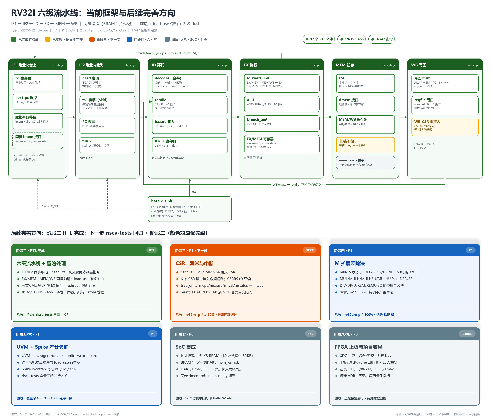

# RV32I 六级流水线：已完成功能记录与后续完善方向（v2）

> **基线日期**：2026-10-20（v2）  
> **代码位置**：`RISC-V32/rtl/core`、`RISC-V32/model_tb`  
> **仿真器**：QuestaSim 2024.1  
> **当前结论**：六级流水线 RTL 已完成，`tb_top` **19/19 PASS**；官方 `riscv-tests` 回归、CSR/异常、M 扩展、SoC 与上板仍待推进。

---

## 目录

- [0. 一页速览](#0-一页速览)
- [1. 框架图与色标](#1-框架图与色标)
- [2. 本次改造清单](#2-本次改造清单)
- [3. 六级流水线架构](#3-六级流水线架构)
- [4. 冒险处理](#4-冒险处理)
- [5. 模块清单与代码索引](#5-模块清单与代码索引)
- [6. 指令支持矩阵（47 条）](#6-指令支持矩阵47-条)
- [7. 验证现状](#7-验证现状)
- [8. 已知问题与技术债](#8-已知问题与技术债)
- [9. 后续完善方向](#9-后续完善方向)
- [10. 维护约定与变更记录](#10-维护约定与变更记录)

---

## 0. 一页速览

| 维度 | 现状 |
|---|---|
| 微架构 | **六级流水线**：IF1 → IF2 → ID → EX → MEM → WB；取指按同步 BRAM 拆两级 |
| 取指 | 同步读、1 拍延迟；`imem_valid[1:0]` 对齐；IF2 内置 **head + tail 取指队列** |
| 译码 | `decode.v` 与 `control_unit.v` 已合并为 **`decoder.v`**，同时输出译码、控制、立即数 |
| 顶层 | `top.v` 只实例化 `rv32_core`；数据通路全部收敛到 `rv32_core.v` |
| 冒险 | EX/MEM、MEM/WB 两级前递；load-use 停顿 1 拍；分支/JAL/JALR 在 EX 解析并 flush 3 级 |
| 指令 | 37 条完整数据通路；FENCE/FENCE.I/ECALL/EBREAK 仅译码；6 条 CSR 仅译码（当前 NOP） |
| 存储器 | 指令：同步读；数据：组合读 + 同步字节写；**无 `mem_ready` 握手** |
| 验证 | `tb_top` **19/19 PASS**，仿真 1216 ns，覆盖转发、load-use、分支、JAL/JALR、store 数据 |
| 代码规模 | **17 个 RTL 文件，2,575 行**（含 `riscv_def.vh`） |
| 旧实现 | 已归档到 `rtl/legacy/single_cycle/`，不参与编译 |
| 所处阶段 | **阶段二 RTL 完成；`riscv-tests` 全量回归尚未跑，阶段二验收未签字** |

**一句话判断**：流水线骨架、前递、停顿和 flush 已经用定向用例证明可用；下一步应先跑 `riscv-tests` 拿到通过率和 CPI，再进入 CSR/异常阶段。

---

## 1. 框架图与色标



> 历史单周期图：[archive/single_cycle_架构框架.png](diagrams/archive/single_cycle_架构框架.png)

**色标定义**：

| 标记 | 颜色 | 含义 |
|---|---|---|
| ✅ | 🟩 绿色实线 | 已实现、已接入流水线、并通过当前定向仿真 |
| ⚠️ | 🟨 琥珀色 | 代码存在但语义不完整（非对齐访问、`WB_CSR`） |
| 🟧 | 橙色 | **阶段三 · 下一步**：CSR/异常/中断 |
| 🟦 | 蓝色 | 阶段四~六 · P1：M 扩展、UVM、Spike 差分 |
| ⬜ | 灰色虚线 | 阶段七/八 · SoC、FPGA 上板 |

**看图要点**：

- 六级之间是**级间寄存器**：PC、IF2 队列、ID/EX、EX/MEM、MEM/WB。
- 上方回环是 **EX 分支/跳转重定向**，冲刷 IF2 队列和 ID/EX，并重定向 IF1。
- 下方回环是 **WB → regfile 写回**，依靠 regfile 的同拍写优先旁路。
- `hazard_unit` 只产生 load-use `stall`；`forward_unit` 在 EX 内完成前递选择。
- 琥珀/灰色块是当前语义缺口与后续接口预留。

---

## 2. 本次改造清单

| 项目 | 改造前（v1） | 改造后（v2） |
|---|---|---|
| 译码 | `decode.v` + `control_unit.v` 两个模块 | **`decoder.v` 单模块**，内部两段式：先识别 `instr_id`，再生成控制 |
| 立即数 | 顶层单独实例化 `imm_gen` | `decoder` 内部实例化 `imm_gen`，对外直接输出 `imm` |
| 顶层 | `top.v` 内是完整单周期数据通路 | **`top.v` 40 行薄壳**，只连接 `rv32_core` 与存储器接口 |
| 流水线 | 无 | **IF1/IF2/ID/EX/MEM/WB 六级**，每个 stage 模块自带输出寄存器 |
| 取指 | 组合读，PC 直接进译码 | 同步读 + `imem_valid` 移位 + **head/tail 取指队列** |
| 数据冒险 | 无 | EX/MEM、MEM/WB 前递 + load-use 停顿 |
| 控制冒险 | 无 | EX 解析，静态预测不跳转，redirect 冲刷 3 级 |
| 验证 | 6 项检查 | **19 项检查**，覆盖转发、停顿、跳转、store 数据 |
| 旧代码 | 混在 `rtl/core` | 归档到 `rtl/legacy/single_cycle/`，不参与编译 |
| 文档/图 | 单周期框架图 | 六级流水线框架图 + 本文 |

**关键 bug 修复**：改造过程中发现“同步取指 + load-use 停顿”会丢掉在途指令，最终用 **head/tail 取指队列 + PC 去重** 解决。详细过程见 [4.4](#44-取指队列为什么必须存在)。

---

## 3. 六级流水线架构

### 3.1 阶段划分

| 级 | 模块 | 本级的寄存器/边界 | 主要工作 | 关键文件 |
|---|---|---|---|---|
| IF1 | `if1_stage` | PC 寄存器 | 产生 `imem_addr`；PC+4 / redirect 选择；`imem_valid[1:0]` 对齐 BRAM 延迟 | `rtl/core/if_stage/if1_stage.v` |
| IF2 | `if2_stage` | head/tail 取指队列 | 捕获同步读出的指令；停顿时把在途指令存入 tail；flush 清空 | `rtl/core/if_stage/if2_stage.v` |
| ID | `id_stage` | ID/EX 寄存器 | `decoder` 译码/控制/立即数；读 `regfile`；生成 hazard 信息 | `rtl/core/id_stage/id_stage.v` |
| EX | `ex_stage` | EX/MEM 寄存器 | 前递选择、ALU、分支比较、redirect 产生 | `rtl/core/ex_stage/ex_stage.v` |
| MEM | `mem_stage` | MEM/WB 寄存器 | LSU 访存、字节掩码、写回数据选择 | `rtl/core/mem_stage/mem_stage.v` |
| WB | `wb_stage` | 纯组合（输入是 MEM/WB） | 写回 `regfile`，统一门控 `valid/wb_en/rd≠0` | `rtl/core/wb_stage/wb_stage.v` |

**为什么是六级**：目标器件 BRAM 是同步读，`imem_addr` 给出后下一拍 `imem_rdata` 才有效。IF 必须拆成 IF1（发地址）和 IF2（捕获指令），因此分支在 EX 解析时实际要冲刷 **IF1/IF2/ID 三级**。

### 3.2 有效位、停顿与冲刷

- 每级都有 `valid`：
  - `if2_valid`：IF2 队列 head 是否有效；
  - `id_ex_valid`、`ex_mem_valid`、`mem_wb_valid`：级间寄存器是否携带真实指令。
- 写回统一门控：
  ```verilog
  assign wb_wen = mem_wb_valid && mem_wb_wb_en && (mem_wb_rd_addr != 5'd0);
  ```
- **stall（load-use）**：冻结 IF1 PC 与 IF2 队列；向 ID/EX 插入 bubble（`valid=0`），让 load 继续走 MEM/WB。
- **flush（redirect）**：清空 IF2 队列与 ID/EX；IF1 的 PC 下一拍装 redirect 目标。
- **优先级**：`redirect > stall`。两者在正常指令序列中通常互斥（load 不会同时产生 redirect），但代码显式保证优先级。

### 3.3 合并后的 decoder

`decoder.v` 仍是组合逻辑，但把原来的“识别”和“控制”放在同一模块内，避免两套 `instruction_id` 解释分叉：

```verilog
// Stage 1: instruction identification（decoder.v:114）
case (opcode)
    `OPCODE_OP:      begin instr_type = `R_TYPE; ... case (funct3) ... endcase end
    `OPCODE_LOAD:    begin instr_type = `I_TYPE; ... end
    `OPCODE_BRANCH:  begin instr_type = `B_TYPE; ... end
    // ...
endcase

// Stage 2: control generation（decoder.v:357）
case (instr_id)
    `ADD, `SUB, `SLL, ...: begin
        wb_en = 1'b1; wb_src = `WB_ALU;
        alu_src1 = `ALUSRC1_RS1; alu_src2 = `ALUSRC2_RS2;
        // ...
    end
    `LB, `LH, `LW, `LBU, `LHU: begin
        wb_en = 1'b1; wb_src = `WB_MEM;
        mem_read = 1'b1; alu_op = `ALU_ADD;
        // ...
    end
    // ...
endcase
```

同时修正了 v1 的一个隐患：CSR 寄存器形式（`CSRRW/CSRRS/CSRRC`）的 `instruction_type` 不再保持 `NONE_TYPE`，而是显式设为 `I_TYPE`（源为 rs1）。CSR 立即数形式仍为 `CSR_TYPE`。

### 3.4 关键数据通路代码

**ID/EX 的停顿插入**（`id_stage.v:203`）：

```verilog
end else if (stall) begin
    // load-use：向 EX 插入 bubble；IF2 保持依赖指令
    id_ex_valid     <= 1'b0;
    id_ex_wb_en     <= 1'b0;
    id_ex_mem_read  <= 1'b0;
    id_ex_mem_write <= 1'b0;
    id_ex_branch    <= 1'b0;
    // ...
end
```

**EX/MEM 写回控制**（`ex_stage.v:168` 起）：把 `alu_result`、`store_data`、`pc_plus4`、`imm`、`rd`、`wb_src` 一起寄存，MEM 级不需要再回看 ID。

**MEM 级写回数据选择**（`mem_stage.v`）：

```verilog
case (ex_mem_wb_src)
    `WB_ALU: wb_data_next = ex_mem_alu_result;
    `WB_MEM: wb_data_next = load_data;
    `WB_PC4: wb_data_next = ex_mem_pc_plus4;
    `WB_IMM: wb_data_next = ex_mem_imm;
endcase
```

---

## 4. 冒险处理

### 4.1 数据前递

`forward_unit` 为 EX 的两个读端口各产生 2 bit 选择：

| 选择 | 来源 | 使用条件 |
|---|---|---|
| `0` | ID/EX 中锁存的寄存器值 | 无冲突 |
| `1` | EX/MEM 的 `alu_result` | EX/MEM 有效、要写回、`rd≠0`、**不是 load** |
| `2` | MEM/WB 的 `wb_data` | MEM/WB 有效、要写回、`rd≠0`，且 EX/MEM 未命中 |

- 优先级：**EX/MEM > MEM/WB**。两条连续指令写同一寄存器时，必须选更新的 EX/MEM。
- load 在 EX/MEM 时不能前递，因为它的 `alu_result` 是地址而不是数据；紧邻消费者由 hazard 停顿 1 拍，然后从 MEM/WB 前递。
- `rd=x0` 不参与前递；regfile 读 x0 恒 0。

`forward_unit` 的核心逻辑：

```verilog
if (ex_mem_valid && ex_mem_wb_en && !ex_mem_is_load && ex_mem_rd_addr != 0) begin
    if (rs1_addr == ex_mem_rd_addr) fwd_a = 2'd1;
    if (rs2_addr == ex_mem_rd_addr) fwd_b = 2'd1;
end
if (mem_wb_valid && mem_wb_wb_en && mem_wb_rd_addr != 0) begin
    if (fwd_a != 2'd1 && rs1_addr == mem_wb_rd_addr) fwd_a = 2'd2;
    if (fwd_b != 2'd1 && rs2_addr == mem_wb_rd_addr) fwd_b = 2'd2;
end
```

### 4.2 load-use 停顿

`hazard_unit` 只在一种情况拉高 `stall`：

```verilog
assign stall = load_in_ex && rd_nonzero && (raw_rs1 || raw_rs2);
```

其中：

- `load_in_ex = id_ex_valid && id_ex_mem_read`；
- `raw_rs1/raw_rs2` 由 ID 指令的 `rs1_used/rs2_used` 与 `rd` 比较得到；
- 停顿 1 拍后，load 在 WB，消费者进 EX，走 MEM/WB 前递；
- store 的 `rs2` 也算使用，因此“load 后紧跟 store 同一寄存器”也会停顿并正确前递。

### 4.3 控制冒险

- 静态预测“不跳转”，分支在 **EX** 解析。
- 条件分支 taken、JAL、JALR 都产生 `ex_redirect`：

```verilog
assign ex_redirect = id_ex_valid &&
                     (id_ex_is_jal || id_ex_is_jalr || taken_branch);

assign ex_redirect_pc = id_ex_is_jalr ? {alu_result[`XLEN-1:1], 1'b0}
                                      : (id_ex_pc + id_ex_imm);
```

- `ex_redirect` 同时：
  1. 让 IF1 下一拍把 PC 装成目标；
  2. 清空 IF2 队列；
  3. 清除 ID/EX（丢弃 ID 中的指令）。
- 由于同步取指拆了两级，taken 时实际丢弃 IF1/IF2/ID 三条年轻指令，即 **3 级 flush**。
- JAL/JALR 的链接值仍走 `WB_PC4`，由 MEM/WB 写回，不受 redirect 影响。

### 4.4 取指队列为什么必须存在

这是本次改造中最值得记录的 bug。

**现象**：加入流水线后，`lw x13` → `add x14` 的 load-use 用例通过，但 `sw x14, 8(x0)` 这条**紧跟其后的 store** 被整条丢掉，`dmem[2]` 一直是 0。

**根因**：

1. 同步 BRAM 有一拍延迟，IF1 的 PC 实际上比 IF2 中的指令**超前两条**。
2. 发生 load-use 停顿时，IF2 保持消费者（`add`），PC 保持在更靠后的地址。
3. 此时“在途”的 `sw` 已经出现在 `imem_rdata` 上，但 IF2 被冻结，没有寄存器接收它；下一拍 BRAM 按保持的 PC 输出**再下一条**，`sw` 就被覆盖了。

**第一版修复（不够）**：在 IF2 加一个 tail 表项，停顿时把 `imem_rdata` 收进 tail。结果又出现两个新问题：

- 停顿期间 PC 保持，BRAM 会**重复输出同一条指令**，导致 head/tail 拿到相同 PC，该指令执行两次；
- redirect 后，旧路径的在途指令仍可能被 tail 接收，导致 JALR 目标指令与旧路径指令**乱序**。

**最终实现**（`if2_stage.v`）：

- **head + tail 两级队列**：head 是 IF2/ID 边界，tail 是 1 深 skid；
- 入队前比较 PC：`if1_pc_q != tail_pc` 才接收，消除停顿期间的重复取指；
- 队列为空时，**仍要求 `if1_data_valid`**；不能因为 head 无效就无条件接收（否则 redirect 后旧路径指令会混入）；
- `flush` 清空 head 和 tail；
- 停顿只影响 head 保持与 tail 捕获，PC 由 IF1 保持。

核心代码：

```verilog
end else if (stall) begin
    // head 保持给 ID；把当前在途指令收进 tail（只收一次）
    if (incoming_new_vs_tail && !tail_valid) begin
        tail_instr <= imem_rdata;
        tail_pc    <= if1_pc_q;
        tail_valid <= 1'b1;
    end
end else begin
    if (tail_valid) begin
        if2_instr <= tail_instr;
        if2_pc    <= tail_pc;
        if2_valid <= 1'b1;
        // incoming 只在不是同一条指令时进入 tail
        if (incoming_new_vs_tail) begin
            tail_instr <= imem_rdata;
            tail_pc    <= if1_pc_q;
            tail_valid <= 1'b1;
        end else begin
            tail_valid <= 1'b0;
        end
    end else begin
        if (if1_data_valid && (!if2_valid || (if1_pc_q != if2_pc))) begin
            if2_instr <= imem_rdata;
            if2_pc    <= if1_pc_q;
            if2_valid <= 1'b1;
        end else begin
            if2_instr <= `NOP;
            if2_pc    <= 32'd0;
            if2_valid <= 1'b0;
        end
    end
end
```

这个队列不是通用 FIFO，而是“1 深 skid + PC 去重”的定向实现，足够覆盖当前单周期停顿；如果后续加入可变延迟存储器（`mem_ready`、总线等待），需要升级为带 valid/ready 的取指 FIFO。

---

## 5. 模块清单与代码索引

### 5.1 活动 RTL（17 个文件，2,575 行）

| 文件 | 行数 | 模块 | 作用 | 状态 |
|---|---:|---|---|---|
| `rtl/riscv_def.vh` | 513 | — | XLEN、opcode/funct、ALU/分支/CSR/WB/流水线编码 | ✅ |
| `rtl/core/top.v` | 40 | `top` | 薄顶层：只连接 `rv32_core` 与存储器接口 | ✅ |
| `rtl/core/rv32_core.v` | 329 | `rv32_core` | 六级流水线小顶层：实例化各级、hazard、forward | ✅ |
| `rtl/core/hazard_unit.v` | 42 | `hazard_unit` | load-use 停顿检测 | ✅ |
| `rtl/core/if_stage/if1_stage.v` | 62 | `if1_stage` | PC、next-PC、`imem_valid` 对齐 | ✅ |
| `rtl/core/if_stage/if2_stage.v` | 92 | `if2_stage` | head/tail 取指队列、flush、PC 去重 | ✅ |
| `rtl/core/id_stage/decoder.v` | 521 | `decoder` | 合并译码 + 控制 + 立即数 | ✅ |
| `rtl/core/id_stage/imm_gen.v` | 21 | `imm_gen` | I/S/B/U/J/CSR 立即数 | ✅ |
| `rtl/core/id_stage/regfile.v` | 26 | `regfile` | 32×32、x0、写优先旁路 | ✅ |
| `rtl/core/id_stage/id_stage.v` | 238 | `id_stage` | decoder + regfile + ID/EX 寄存器 | ✅ |
| `rtl/core/ex_stage/forward_unit.v` | 46 | `forward_unit` | EX/MEM、MEM/WB 前递选择 | ✅ |
| `rtl/core/ex_stage/alu.v` | 33 | `alu` | 10 种整数运算 | ✅ |
| `rtl/core/ex_stage/branch_unit.v` | 45 | `branch_unit` | 6 种条件分支 + 目标 | ✅ |
| `rtl/core/ex_stage/ex_stage.v` | 203 | `ex_stage` | 前递、ALU、分支、EX/MEM 寄存器 | ✅ |
| `rtl/core/mem_stage/lsu.v` | 228 | `lsu` | 字节/半字/字、掩码、扩展 | ✅ |
| `rtl/core/mem_stage/mem_stage.v` | 110 | `mem_stage` | LSU、写回选择、MEM/WB 寄存器 | ✅ |
| `rtl/core/wb_stage/wb_stage.v` | 26 | `wb_stage` | 写回 regfile | ✅ |

### 5.2 归档（不参与编译）

`rtl/legacy/single_cycle/`：

- `top.v`（单周期顶层）、`deocde.v`、`control_unit.v`、`instr_decoder.v`
- `pc_reg.v`、`pc_plus4.v`、`mux.v`、`mux_2_alu.v`
- `改进.md`、`README.md`

### 5.3 验证与脚本

| 文件 | 说明 |
|---|---|
| `model_tb/tb_top.v` | 同步指令存储器 + 组合数据存储器 + 19 项检查 |
| `model_tb/filelist.f` | 只包含活动 RTL + tb；不再编译 legacy |
| `model_tb/makefile` | `make sim` 控制台回归；`make gui` 交互波形 |

### 5.4 建议阅读顺序

1. `rtl/core/top.v` → `rv32_core.v`：先看六级如何串起来。
2. `if1_stage.v` / `if2_stage.v`：同步取指与取指队列。
3. `decoder.v`：合并后的译码/控制。
4. `id_stage.v`：ID/EX 寄存器与 stall 插 bubble。
5. `forward_unit.v` / `ex_stage.v`：前递、分支、redirect。
6. `mem_stage.v` / `wb_stage.v`：访存与写回。

---

## 6. 指令支持矩阵（47 条）

> “完整”= 译码 + 控制 + 数据通路均已实现，且能进入流水线执行。  
> “仅译码”= `decoder` 能识别，但控制默认无副作用，当前等效 NOP。

### 6.1 已完成（37 条）

| 类别 | 指令 | 数量 | 关键实现 |
|---|---|---:|---|
| R 型 | ADD/SUB/SLL/SLT/SLTU/XOR/SRL/SRA/OR/AND | 10 | `ALU_*` + `WB_ALU` |
| I 型算术 | ADDI/SLTI/SLTIU/XORI/ORI/ANDI/SLLI/SRLI/SRAI | 9 | `ALUSRC2_IMM` + `WB_ALU` |
| Load | LB/LH/LW/LBU/LHU | 5 | LSU + `WB_MEM` |
| Store | SB/SH/SW | 3 | LSU 掩码 + 同步写 |
| 条件分支 | BEQ/BNE/BLT/BGE/BLTU/BGEU | 6 | EX `branch_unit` + redirect |
| 跳转 | JAL/JALR | 2 | `WB_PC4` + redirect |
| 高位立即数 | LUI/AUIPC | 2 | `WB_IMM` / `ALUSRC1_PC` |
| **合计** | | **37** | |

### 6.2 仅译码（10 条）

| 指令 | 译码 | 数据通路 | 当前行为 |
|---|---|---|---|
| FENCE | ✅ | ❌ | 无内存序语义，等效 NOP |
| FENCE.I | ✅ | ❌ | 无指令流同步，等效 NOP |
| ECALL | ✅ | ❌ | 不陷入、不写 `mepc/mcause` |
| EBREAK | ✅ | ❌ | 不进入调试异常 |
| CSRRW | ✅ | ❌ | 无 `csr_file`，无 `WB_CSR` |
| CSRRS | ✅ | ❌ | 同上；`CSRRS x0` 纯读语义未实现 |
| CSRRC | ✅ | ❌ | 同上 |
| CSRRWI | ✅ | ❌ | `zimm` 已能生成，但无 CSR 目标 |
| CSRRSI | ✅ | ❌ | 同上 |
| CSRRCI | ✅ | ❌ | 同上 |

**统计**：✅ 37 + ⚠️ 10 = **47**。

> 注意：`system_instr` 目前只是 decoder 的输出标记，尚未被 trap 单元消费。阶段三接入 `csr_file`/`trap_unit` 后，这 10 条才会形成真实架构行为。

---

## 7. 验证现状

### 7.1 Testbench 结构

`model_tb/tb_top.v`：

- **同步指令存储器**：`always @(posedge clk) imem_rdata <= imem[imem_addr[31:2]]`，1 拍延迟。
- **组合数据存储器读 + 同步字节写**：与当前核心接口一致。
- 复位保持 2 个时钟沿，释放后跑 **120 个周期**。
- `illegal_instr` 一旦为 1 立即 `$finish` 并报 `[FAIL]`。
- 19 个观测点，全部通过则打印 `[PASS] tb_top completed with no errors.`。

### 7.2 测试程序

**第一段：基本数据通路 / 分支 / 跳转**

| PC | 汇编 | 预期 |
|---|---|---|
| 0x00 | `addi x1, x0, 5` | x1=5 |
| 0x04 | `addi x2, x0, 7` | x2=7 |
| 0x08 | `add x3, x1, x2` | x3=12（EX/MEM 前递） |
| 0x0c | `sw x3, 0(x0)` | dmem[0]=12（store 数据前递） |
| 0x10 | `lw x4, 0(x0)` | x4=12 |
| 0x14 | `beq x4, x3, +8` | 跳到 0x1c（load-use + 分支） |
| 0x18 | `addi x5, x0, 1` | 被 flush |
| 0x1c | `jal x6, +8` | x6=0x20（JAL 链接 + redirect） |
| 0x20 | `addi x5, x0, 2` | 被 flush |
| 0x24 | `addi x5, x0, 3` | x5=3 |
| 0x28 | `addi x7, x0, 0x34` | x7=0x34 |
| 0x2c | `jalr x8, 0(x7)` | x8=0x30，跳到 0x34 |
| 0x30 | `addi x5, x0, 4` | 被 flush |
| 0x34 | `sw x5, 4(x0)` | dmem[1]=3 |
| 0x38 | `jal x0, +8` | 跳到 0x40 |

**第二段：定向冒险用例**

| PC | 汇编 | 覆盖点 |
|---|---|---|
| 0x40 | `addi x9, x0, 1` | — |
| 0x44 | `addi x10, x0, 2` | — |
| 0x48 | `add x11, x9, x10` | 相邻 RAW 前递 |
| 0x4c | `add x12, x11, x9` | EX/MEM 前递 |
| 0x50 | `lw x13, 0(x0)` | load |
| 0x54 | `add x14, x13, x13` | **load-use 停顿 + MEM/WB 前递** |
| 0x58 | `sw x14, 8(x0)` | store 数据前递 |
| 0x5c | `lw x15, 8(x0)` | load 后紧跟 store |
| 0x60 | `sw x15, 12(x0)` | **load-use（store 数据）** |
| 0x64 | `bne x14, x15, +8` | 分支 not taken |
| 0x68 | `addi x16, x0, 0x55` | 验证 not taken 后继续执行 |
| 0x6c | `jal x0, 0` | 停止循环 |

### 7.3 仿真结果

```
# [PASS] dmem[0] ADD/SW/LW = 0x0000000c
# [PASS] dmem[1] branch/jump = 0x00000003
# [PASS] x1 ADDI = 0x00000005
# [PASS] x2 ADDI = 0x00000007
# [PASS] x3 ADD forwarding = 0x0000000c
# [PASS] x4 load result = 0x0000000c
# [PASS] x5 skipped paths = 0x00000003
# [PASS] x6 JAL link = 0x00000020
# [PASS] x8 JALR link = 0x00000030
# [PASS] x9 ADDI = 0x00000001
# [PASS] x10 ADDI = 0x00000002
# [PASS] x11 ADD forward = 0x00000003
# [PASS] x12 EX/MEM forward = 0x00000004
# [PASS] x13 load = 0x0000000c
# [PASS] x14 load-use forward = 0x00000018
# [PASS] x15 load after store = 0x00000018
# [PASS] x16 branch not taken = 0x00000055
# [PASS] dmem[2] store forwarded data = 0x00000018
# [PASS] dmem[3] store after load = 0x00000018
#
# [PASS] tb_top completed with no errors.
# ** Note: $finish : ./tb_top.v(167)
#    Time: 1216 ns
```

编译：`Errors: 0, Warnings: 0`；仿真仅 vopt 的 `+acc` 警告。

### 7.4 复现

```powershell
cd RISC-V32\model_tb
make sim          # vlib/vmap/vlog -sv + vsim -c
make gui          # QuestaSim GUI + start.do 波形
```

### 7.5 覆盖缺口

- 仅覆盖 8 类指令：ADDI/ADD/LW/SW/BEQ/BNE/JAL/JALR；
- ALU 其余运算、LB/LH/LBU/LHU、SB/SH、BLT/BGE/BLTU/BGEU、LUI/AUIPC 未被定向测试；
- 未跑官方 `riscv-tests`，未测 CPI、前递命中率、stall 占比；
- 未覆盖 CSR/FENCE/ECALL/EBREAK（当前 NOP）；
- 未做非法指令、非对齐访问的异常测试。

> 结论：**19/19 PASS 只证明当前定向用例和流水线控制正确，不等于阶段二验收完成**。阶段二还差 `rv32ui-p-*` 全量回归与 CPI 数据。

---

## 8. 已知问题与技术债

| # | 问题 | 位置 | 影响 | 建议 | 优先级 |
|---|---|---|---|---|---:|
| 1 | **RTL 仍未纳入 Git** | 仓库根 | 误删/覆盖不可恢复 | `git add rtl model_tb doc` 并提交基线 | P0 |
| 2 | **`riscv-tests` 未跑** | `model_tb` | 无法证明 RV32I 全量兼容；阶段二验收未完成 | 编译 `rv32ui-p-*`，建立回归脚本与通过率 | P0 |
| 3 | 数据存储器组合读、无握手 | `mem_stage`/`lsu` | 无法直接接同步 BRAM/总线；load 可能在数据未返回时写回 | 增加 `mem_ready`/`valid`，MEM 级停顿 | P0（SoC 前） |
| 4 | CSR/异常/中断缺失 | 全局 | CSR/ECALL/EBREAK/FENCE 静默 NOP | 阶段三：`csr_file` + `trap_unit` + `mret` | P1 |
| 5 | 非对齐访问静默屏蔽 | `lsu.v` | 违反 RV32I 非对齐 load/store 异常要求 | 产生 `misaligned` 异常，或拆分访问 | P1 |
| 6 | JAL/JALR 目标未校验 4 字节对齐 | `ex_stage.v` | 无 C 扩展时应触发指令地址非对齐异常 | trap 接入后加校验 | P1 |
| 7 | `system_instr` 无消费者 | `decoder.v` | FENCE/CSR/ECALL 仅标记，未形成行为 | 阶段三接入 trap/CSR | P1 |
| 8 | 取指队列用 PC 去重是定向方案 | `if2_stage.v` | 若后续存储器延迟可变，可能不够通用 | 升级为带 valid/ready 的取指 FIFO | P2 |
| 9 | 无存储器等待状态 | `mem_stage.v` | 无法接慢速外设/总线 | 增加 `mem_ready`，扩展 hazard | P2 |
| 10 | `regfile` 无复位 | `regfile.v` | 仿真初期 X 传播 | TB 初始化，或加仅仿真复位 | P2 |
| 11 | 未启用 `` `default_nettype none `` | 全部 RTL | 拼写错误生成隐式网络 | 文件头启用并在末尾恢复 | P2 |
| 12 | 无 SVA/断言 | 全部 RTL | stall/flush 互斥、valid 传播靠人工检查 | 加 `stall && flush` 互斥等断言 | P2 |
| 13 | 未测 CPI/前递命中率/stall 占比 | 验证 | 缺少简历量化指标 | 在 TB 或计数器里统计 | P1 |
| 14 | `decoder` 521 行组合块较大 | `decoder.v` | 可读性和时序分析一般 | 用函数/表驱动拆分 opcode/funct 译码 | P3 |
| 15 | 部分端口/信号未使用 | `mem_stage`、`id_stage` | 增加 lint 噪声 | 清理 `ex_mem_pc/is_load/is_store`、`id_ex_pc_src` | P3 |
| 16 | `make clean` 可能因 `_opt` 锁定告警 | `model_tb` | 不影响编译，但 clean 返回非零 | 关闭残留 vsim 或删除 `work/_opt` | P3 |

**已修复（v1 → v2）**：

- 双译码器并存 → 合并为 `decoder.v`；文件名 `deocde.v` 已随旧实现归档。
- CSR 寄存器形式 `instruction_type` 未赋值 → 显式设为 `I_TYPE`。
- 单周期数据通路 → 六级流水线；`top.v` 只保留流水线接口。
- 取指停顿丢指令 → head/tail 队列 + PC 去重。

---

## 9. 后续完善方向

### 9.1 路线总表

| 阶段 | 颜色 | 优先级 | 目标 | 关键交付 | 验收 |
|---|---|---|---|---|---|
| 阶段一 | 🟩 绿 | P0 | 单周期 RV32I 子集 | 37 条数据通路 + 6 项检查 | 已归档 |
| **阶段二** | 🟩 绿 | **P0** | **六级流水线 + 冒险** | 级间寄存器、取指队列、前递、load-use、3 级 flush | **RTL 完成；19/19 定向 PASS；待 `rv32ui-p-*` 100% + CPI** |
| **阶段三** | 🟧 橙 | P1 | **CSR、异常与中断** | `csr_file`（12 CSR）、`trap_unit`、`mret`、计数器 | `rv32mi-p-*` ≥ 90%；异常回环 |
| 阶段四 | 🟦 蓝 | P1 | M 扩展乘除法 | `muldiv`、DSP48E1、除零/溢出特例 | `rv32um-p-*` 100% |
| 阶段五 | 🟦 蓝 | P1 | UVM 验证平台 | env/agent/scoreboard/coverage | ≥ 100 万条随机；覆盖率 ≥ 95% |
| 阶段六 | 🟦 蓝 | P1 | Spike 差分 | DPI-C lockstep、自动 diff、CI | 1000 程序一致 |
| 阶段七 | ⬜ 灰 | P0 | SoC 集成 | 总线、BRAM、UART、Timer、GPIO | 串口 Hello World |
| 阶段八 | ⬜ 灰 | P0 | FPGA 上板 | XDC、综合实现、时序收敛 | 上板稳定运行 |
| 阶段九 | ⬜ 灰 | P0 | 收尾 | ADR、周记、简历指标 | 文档/仓库完整 |

### 9.2 立即要做（阶段二收尾）

1. **提交 Git 基线**：当前改动仍未跟踪，先 `git add rtl model_tb doc` 并提交。
2. **跑 `rv32ui-p-*` 全量**：编译 `riscv-tests`，用 `+imem`/hex 或链接脚本加载到 TB；记录通过/失败列表。
3. **测 CPI**：在 TB 里统计有效退休指令数与总周期；或先加 `mcycle/minstret`（阶段三一并做）。
4. **加断言**：`stall && flush` 互斥、`id_ex_valid` 与 `id_ex_wb_en` 一致性、redirect 时队列清空。
5. **升级取指队列（可选）**：如果回归中发现停顿/重定向组合问题，把 head/tail 换成标准 valid/ready FIFO。

### 9.3 阶段三：CSR、异常与中断

| 任务 | 要点 |
|---|---|
| `csr_file` | 12 个 Machine CSR：`mstatus/misa/mie/mip/mtvec/mscratch/mepc/mcause/mtval/mcycle/minstret/mhartid` |
| 6 条 CSR 指令 | 接入 `WB_CSR`；`CSRRS/CSRRC` 的 `rs1=x0` 不写；立即数变体用 zimm |
| 只读保护 | CSR 地址高 2 位为 `2'b11` 时写操作触发非法指令异常 |
| `trap_unit` | 异常优先级、`mepc/mcause/mtval` 写入、跳转 `mtvec` |
| `mret` | 从 `mepc` 返回，恢复 `mstatus.MIE/MPIE` |
| 对齐异常 | 指令地址非对齐、load/store 非对齐 |
| 计数器 | `mcycle/minstret` 用于 CPI |

**mepc 语义**：异常存“出错指令本身的 PC”；中断存“下一条待执行指令的 PC”。

### 9.4 阶段四：M 扩展

- `muldiv` 状态机：`IDLE/BUSY/DONE`；busy 时 stall。
- 乘法：MUL/MULH/MULHSU/MULHU，先让 Vivado 推断 DSP48E1。
- 除法：DIV/DIVU/REM/REMU，32 拍恢复余数法。
- 特例：除零、`-2^31 / -1` 不产生异常。
- 接入：`muldiv_busy` 扩展到 hazard，写回走 `WB_ALU`。

### 9.5 阶段五/六：验证闭环

- UVM：env/agent/driver/monitor/scoreboard/sequencer。
- 约束随机：相邻指令 `rs1/rs2` 高概率依赖前一条 `rd`，提高前递/load-use 命中。
- 覆盖率：指令类型 × 冒险场景 × 分支方向 × CSR 读写。
- Spike：commit log + DPI-C lockstep，对比 PC/rd/写回值/CSR。
- CI：riscv-tests + 随机回归 + 差分。

### 9.6 阶段七/八：SoC 与上板

- 地址映射（建议）：

| 地址范围 | 设备 | 大小 |
|---|---|---|
| `0x0000_0000 – 0x0000_7FFF` | 指令 BRAM | 32 KB |
| `0x0000_8000 – 0x0000_FFFF` | 数据 BRAM | 32 KB |
| `0x1000_0000 – 0x1000_000F` | UART | 16 B |
| `0x1000_1000 – 0x1000_100F` | Timer | 16 B |
| `0x1000_2000 – 0x1000_200F` | GPIO | 16 B |
| `0x0C00_0000 – 0x0C00_0FFF` | PLIC | 4 KB |

- BRAM 必须用字节写使能对接 `mem_wmask`；读延迟 1 拍，需要 `mem_ready`/stall。
- UART 分频：`50 MHz / 115200 ≈ 434`。
- 异步输入（UART RX、按键）两级同步。
- 上板记录 LUT/FF/BRAM/DSP/Fmax。

### 9.7 待记录的量化指标

| 指标 | 当前 | 目标 |
|---|---|---|
| 定向检查 | 19/19 PASS | — |
| `rv32ui-p-*` 通过率 | 未跑 | 100% |
| CPI | 未测 | 记录 |
| 前递命中率 | 未统计 | 记录 |
| stall 周期占比 | 未统计 | 记录 |
| Fmax / 资源 | 未综合 | 记录 |
| 功能/代码覆盖率 | 未收集 | ≥ 95% |

---

## 10. 维护约定与变更记录

### 10.1 更新规则

1. 每完成一个阶段，更新“模块清单/指令矩阵/路线总表”。
2. 重新生成框架图，保持色标一致。
3. 在“已知问题”表中关闭已解决项，新增新发现项。

### 10.2 色标不变量

- 绿色：已接入 + 已通过当前仿真。
- 琥珀：代码存在但未接入/语义不完整。
- 橙色：阶段三（下一步）。
- 蓝色：阶段四~六。
- 灰色：阶段七/八。

### 10.3 变更记录

| 日期 | 版本 | 变更 |
|---|---|---|
| 2026-10-20 | v1 | 单周期 RV32I 子集；37/47 指令；`tb_top` 6/6 PASS；13 文件 2,667 行 |
| 2026-10-20 | v2 | **合并 decode + control_unit 为 `decoder.v`；六级流水线 IF1/IF2/ID/EX/MEM/WB；head/tail 取指队列；EX/MEM、MEM/WB 前递；load-use 停顿；3 级 flush；`top.v` 薄壳化；tb 19/19 PASS**；旧单周期实现归档；框架图重新生成 |

> 本文的“完成”以 RTL 实际连接和仿真结果为准。`riscv-tests` 未跑之前，不把阶段二描述为“已验收”。
