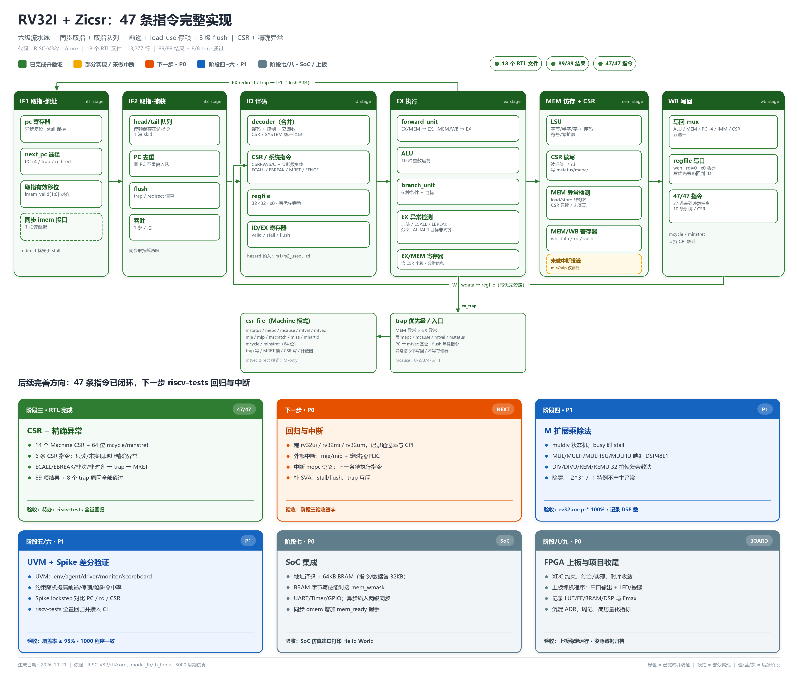

# RV32I + Zicsr：47 条指令完整实现与后续完善方向

> **基线日期**：2026-10-21（v3）；验证与修复更新：2026-10-23（v3.1）  
> **代码位置**：`RISC-V32/rtl/core`、`RISC-V32/model_tb`  
> **仿真器**：QuestaSim 2024.1  
> **当前结论**：**47/47 条 RV32I + Zicsr 指令全部可用**；`tb_top` **89/89 结果 + 8/8 trap 通过**；官方 `riscv-tests`、外部中断、M 扩展、SoC 与上板仍待推进。

---

## 目录

- [0. 一页速览](#0-一页速览)
- [1. 框架图与色标](#1-框架图与色标)
- [2. v2 → v3 完善清单](#2-v2--v3-完善清单)
- [3. 六级流水线](#3-六级流水线)
- [4. CSR、异常与系统指令](#4-csr异常与系统指令)
- [5. 冒险处理](#5-冒险处理)
- [6. 模块清单与代码索引](#6-模块清单与代码索引)
- [7. 47 条指令支持矩阵](#7-47-条指令支持矩阵)
- [8. 验证现状](#8-验证现状)
- [9. 已知问题与技术债](#9-已知问题与技术债)
- [10. 后续完善方向](#10-后续完善方向)
- [11. 变更记录](#11-变更记录)

---

## 0. 一页速览

| 维度 | 现状 |
|---|---|
| 指令集 | **RV32I 41 条 + Zicsr 6 条 = 47 条全部可用**；额外实现 `MRET` |
| 微架构 | 六级流水线：IF1 → IF2 → ID → EX → MEM → WB；同步取指、head/tail 取指队列 |
| 冒险 | EX/MEM、MEM/WB 前递；load-use / CSR-use 停顿；分支/JAL/JALR 在 EX 解析并 flush 3 级 |
| CSR | 14 个 Machine CSR（含 64 位 `mcycle/minstret` 高低半）；CSR 读写、只读保护、未实现地址异常 |
| 异常 | 非法指令、ECALL、EBREAK、指令/load/store 非对齐、CSR 只读/未实现；MEM 异常优先于 EX |
| 陷门 | `mtvec` direct 模式；`mepc/mcause/mtval/mstatus` 硬件更新；`MRET` 返回 |
| 顶层 | `top.v` 只连接 `rv32_core` 与存储器；`csr_file` 独立模块 |
| 验证 | `tb_top` **89/89 结果 + 8/8 trap**；独立模块 **17/17 通过、174 项定向检查**；回归脚本 7 项自检 |
| 代码规模 | **18 个 RTL 文件，3,277 行**（含 `riscv_def.vh`） |
| 测试程序 | 380 条指令字，自动生成 `program.hex` / `expected.hex` / `trap_expected.hex` |
| 所处阶段 | 阶段三 **RTL 完成**；`riscv-tests` 与外部中断未做，阶段三验收未签字 |

**一句话判断**：RV32I + Zicsr 的指令与异常闭环已经跑通；下一步是用官方测试集证明兼容性，并补外部中断投递。

---

## 1. 框架图与色标



> 历史版本：[pipeline_v2_架构框架.png](diagrams/archive/pipeline_v2_架构框架.png) ｜ [single_cycle_架构框架.png](diagrams/archive/single_cycle_架构框架.png)

**色标定义**：

| 标记 | 颜色 | 含义 |
|---|---|---|
| ✅ | 🟩 绿色实线 | 已实现、已接入流水线、并通过当前定向仿真 |
| ⚠️ | 🟨 琥珀色 | 部分实现：`mie/mip` 只有存储，没有外部中断投递 |
| 🟧 | 橙色 | **下一步 · P0**：riscv-tests 回归 + 外部中断 |
| 🟦 | 蓝色 | 阶段四~六 · P1：M 扩展、UVM、Spike 差分 |
| ⬜ | 灰色虚线 | 阶段七/八 · SoC、FPGA 上板 |

**看图要点**：

- 六级流水线之间仍是级间寄存器：PC、IF2 队列、ID/EX、EX/MEM、MEM/WB。
- `csr_file` 挂在 MEM 级：CSR 读旧值、写新值，读值经 `WB_CSR` 写回。
- EX 级检测非法/ECALL/EBREAK/目标非对齐；MEM 级检测 load/store 非对齐与 CSR 只读/未实现。
- MEM 异常更老，优先于 EX；trap 统一写 `mepc/mcause/mtval/mstatus` 并跳到 `mtvec`。
- `MRET` 在 EX 解析，读 `mepc` 并更新 `mstatus`。

---

## 2. v2 → v3 完善清单

| 项目 | v2（六级流水线） | v3（当前） |
|---|---|---|
| 指令覆盖 | 37/47；FENCE/ECALL/EBREAK/CSR 为 NOP | **47/47 全部可用** |
| CSR | 无 | `csr_file`：14 个 Machine CSR + 64 位计数器 |
| 6 条 CSR 指令 | 仅译码 | CSRRW/S/C + 立即数变体完整读写 |
| ECALL/EBREAK | 仅译码 | 真实 trap（cause 11/3），handler 可返回 |
| FENCE/FENCE.I | 仅译码 | FENCE 执行；FENCE.I flush 流水线 |
| MRET | 无 | 实现，trap handler 用它返回 |
| 异常 | 仅 `illegal_instr` 指示 | 精确异常：非法、非对齐、CSR 只读/未实现 |
| `mstatus` | 无 | MIE/MPIE/MPP；trap/MRET 硬件更新 |
| 计数器 | 无 | `mcycle/minstret`（64 位，含高低半） |
| 验证 | 19 项检查 | **89 项结果 + 8 个 trap 原因** |
| 测试程序 | 手写两段汇编 | Python DSL 生成，覆盖 47 条 + 8 类异常 |
| 前递 | EX/MEM 统一用 ALU 结果 | **按写回源前递**（ALU/PC+4/IMM），load/CSR 走停顿 + MEM/WB |

**v3 修掉的关键 bug**：v2 的 EX/MEM 前递对所有指令都取 `alu_result`。这对 LUI（IMM）、JAL/JALR（PC+4）、CSR（CSR 读值）都是错的，表现为“下一条指令用到上一条结果时拿到错误值”。v3 增加 `ex_mem_wb_data`（按 `wb_src` 选择最终写回值），并对 load/CSR 读增加 1 拍停顿，问题消失。

---

## 3. 六级流水线

### 3.1 阶段划分

| 级 | 模块 | 本级的寄存器/边界 | 主要工作 |
|---|---|---|---|
| IF1 | `if1_stage` | PC 寄存器 | `imem_addr`、PC+4/trap/redirect 选择、`imem_valid[1:0]` 对齐 BRAM 延迟 |
| IF2 | `if2_stage` | head/tail 取指队列 | 捕获同步读指令；停顿保存 skid；trap/redirect 清空 |
| ID | `id_stage` | ID/EX 寄存器 | 合并 decoder（含 CSR/SYSTEM 译码）、regfile、hazard 信息 |
| EX | `ex_stage` | EX/MEM 寄存器 | 前递、ALU、分支、CSR 源操作数、异常检测、redirect/MRET |
| MEM | `mem_stage` | MEM/WB 寄存器 | LSU、CSR 读写、非对齐/CSR 异常、写回数据选择 |
| WB | `wb_stage` | 纯组合 | 写回 regfile，门控 `valid/wb_en/rd≠0` |

**为什么是六级**：目标器件 BRAM 同步读，地址给出后下一拍数据才有效；IF 必须拆成 IF1（发地址）和 IF2（捕获指令），因此分支在 EX 解析时实际冲刷 **IF1/IF2/ID 三级**。

### 3.2 有效位与冲刷

- 每级都有 `valid`：`if2_valid`、`id_ex_valid`、`ex_mem_valid`、`mem_wb_valid`。
- 写回门控：`wb_wen = mem_wb_valid && mem_wb_wb_en && rd != 0`。
- **stall**：load-use 或 CSR 读后立即使用其 `rd`；冻结 IF1/IF2，ID/EX 插 bubble。
- **flush**：分支/JAL/JALR/MRET/FENCE.I 或 trap；清空 IF2 队列与 ID/EX，重定向 PC。
- **优先级**：trap > redirect > stall。

### 3.3 取指队列

`if2_stage` 是 head + tail 的 1 深 skid：

- 正常：head 每拍被 ID 消费，tail/incoming 补位；
- 停顿时：head 保持，incoming 存入 tail；
- 入队前比较 PC，避免停顿期间 BRAM 重复输出同一条指令；
- 队列为空时仍要求 `if1_data_valid`，避免 redirect 后旧路径指令混入；
- trap/redirect 清空 head 和 tail。

---

## 4. CSR、异常与系统指令

### 4.1 CSR 映射

| CSR | 地址 | 行为 |
|---|---|---|
| `mstatus` | `0x300` | MIE(3)、MPIE(7)、MPP(12:11)；trap/MRET 更新 |
| `misa` | `0x301` | 只读常量 `0x4000_0100`（RV32I）；写忽略 |
| `mie` | `0x304` | 存储；暂无中断投递 |
| `mtvec` | `0x305` | direct 模式；trap 目标 `{mtvec[31:2],2'b00}` |
| `mscratch` | `0x340` | 完整读写 |
| `mepc` | `0x341` | 完整读写；写入时低 2 位清零 |
| `mcause` | `0x342` | 完整读写；trap 写入异常原因 |
| `mtval` | `0x343` | 完整读写；trap 写入 fault 信息 |
| `mip` | `0x344` | 存储；暂无中断投递 |
| `mcycle` | `0xB00` | 64 位周期计数低半 |
| `minstret` | `0xB02` | 64 位退休计数低半 |
| `mcycleh` | `0xB80` | 64 位周期计数高半 |
| `minstreth` | `0xB82` | 64 位退休计数高半 |
| `mhartid` | `0xF14` | 只读 0；写触发非法指令异常 |

### 4.2 6 条 CSR 指令

| 指令 | 读 | 写条件 | rd 写回 |
|---|---|---|---|
| `CSRRW` | 读旧值 | 总是写（`rs1=x0` 写 0） | 旧值 |
| `CSRRS` | 读旧值 | `rs1 != x0` 时写 `old OR rs1` | 旧值 |
| `CSRRC` | 读旧值 | `rs1 != x0` 时写 `old & ~rs1` | 旧值 |
| `CSRRWI` | 读旧值 | 总是写 `zimm` | 旧值 |
| `CSRRSI` | 读旧值 | `zimm != 0` 时写 `old OR zimm` | 旧值 |
| `CSRRCI` | 读旧值 | `zimm != 0` 时写 `old & ~zimm` | 旧值 |

- CSR 读在 **MEM** 级，写也在 MEM 级；读旧值、写新值同拍完成。
- 写只读 CSR（地址高 2 位 `2'b11`）或未实现 CSR → 精确异常（cause 2），不写 CSR、不写 rd。
- `CSRRS/CSRRC` 的 `rs1=x0` 是纯读，不写；`CSRRSI/CSRRCI` 的 `zimm=0` 同样不写。

### 4.3 异常与 trap

| cause | 触发条件 | `mtval` |
|---:|---|---|
| 0 | 指令地址非对齐（分支/JAL/JALR/MRET 目标） | 目标地址 |
| 2 | 非法指令 / 写只读 CSR / 访问未实现 CSR | 指令字 |
| 3 | `EBREAK` | 0 |
| 4 | load 地址非对齐 | 访存地址 |
| 6 | store 地址非对齐 | 访存地址 |
| 11 | `ECALL` from M-mode | 0 |

**优先级**：MEM 级异常比 EX 级更老，`MEM > EX`。trap 时：

1. `mepc ← 出错指令 PC`（低 2 位清零）；
2. `mcause ← cause`，`mtval ← fault 信息`；
3. `mstatus.MPIE ← MIE`，`MIE ← 0`，`MPP ← 3`；
4. `PC ← {mtvec[31:2], 2'b00}`；
5. 清空 IF2 队列与 ID/EX；异常指令不写回、不写存储器、不写 CSR。

### 4.4 MRET

- 在 EX 解析：`PC ← {mepc[31:2], 2'b00}`。
- `mstatus.MIE ← MPIE`，`MPIE ← 1`，`MPP ← 3`。
- 与同拍 older CSR 写 `mepc` 有旁路：core 把 `mem_csr_wdata` 直接送给 MRET 目标，因此 trap handler 里“先 `csrw mepc`、紧接着 `mret`”能拿到新值。

### 4.5 关键代码

**CSR 读写（MEM）**：

```verilog
always @(*) begin
    case (ex_mem_csr_op)
        `CSR_OP_WRITE: csr_wdata_calc = ex_mem_csr_src_data;
        `CSR_OP_SET:   csr_wdata_calc = csr_rdata | ex_mem_csr_src_data;
        `CSR_OP_CLEAR: csr_wdata_calc = csr_rdata & ~ex_mem_csr_src_data;
        default:       csr_wdata_calc = csr_rdata;
    endcase
end
```

**非法/只读检测**：

```verilog
assign csr_bad_addr = ex_mem_csr && !csr_implemented;
assign csr_readonly = ex_mem_csr && ex_mem_csr_wen &&
                      (ex_mem_csr_addr[11:10] == 2'b11);
assign mem_trap = load_misaligned || store_misaligned ||
                  (ex_mem_valid && (csr_bad_addr || csr_readonly));
```

**trap 优先级（core）**：

```verilog
assign trap_taken   = mem_trap | ex_trap;
assign trap_pc_w    = mem_trap ? ex_mem_pc : id_ex_pc;
assign trap_cause_w = mem_trap ? mem_trap_cause : ex_trap_cause;
assign trap_tval_w  = mem_trap ? mem_trap_tval  : ex_trap_tval;
assign pc_redirect  = trap_taken | ex_redirect;
```

**mstatus 更新（csr_file）**：

```verilog
if (trap) begin
    ms_next[`MSTATUS_MPIE_BIT] = ms_next[`MSTATUS_MIE_BIT];
    ms_next[`MSTATUS_MIE_BIT]  = 1'b0;
    ms_next[12:11]             = 2'b11;
end
```

---

## 5. 冒险处理

### 5.1 前递

| 来源 | 数据 | 条件 |
|---|---|---|
| EX/MEM | `ex_mem_wb_data`（ALU / PC+4 / IMM） | 有效、要写回、`rd≠0`、**不是 load/CSR** |
| MEM/WB | `mem_wb_wb_data`（最终写回值） | 有效、要写回、`rd≠0`，且 EX/MEM 未命中 |

优先级 **EX/MEM > MEM/WB**。

> load 在 EX/MEM 时数据还没读出来；CSR 读值也在 MEM 才产生。两者都不能从 EX/MEM 前递，必须停顿 1 拍后从 MEM/WB 前递。

### 5.2 load-use / CSR-use 停顿

```verilog
assign load_in_ex = id_ex_valid && id_ex_mem_read;
assign csr_in_ex  = id_ex_valid && id_ex_csr && id_ex_wb_en;
assign stall = (load_in_ex || csr_in_ex) && rd_nonzero &&
               (raw_rs1 || raw_rs2);
```

- store 的 `rs2` 算使用，因此“load 后紧跟 store 同一寄存器”会停顿并正确前递。
- CSR 读后立即用其 `rd` 也会停顿 1 拍；`CSRRS x0` 这类纯读（`rd=x0`）不会误停。

### 5.3 控制冒险

- 静态预测不跳转；分支/JAL/JALR/MRET/FENCE.I 都在 EX 解析。
- `ex_redirect` 与 trap 一起驱动 IF1 的 `pc_redirect`；同时清空 IF2/ID。
- 目标非 4 字节对齐时不 redirect，转 cause 0 异常。
- 同步取指拆两级，taken 时实际丢弃 IF1/IF2/ID 三条年轻指令。

---

## 6. 模块清单与代码索引

### 6.1 活动 RTL（18 个文件，3,277 行）

| 文件 | 行数 | 模块 | 作用 |
|---|---:|---|---|
| `rtl/riscv_def.vh` | 556 | — | 编码、CSR 地址、异常原因、mstatus 位 |
| `rtl/core/top.v` | 47 | `top` | 薄顶层，连接 core 与存储器 |
| `rtl/core/rv32_core.v` | 474 | `rv32_core` | 六级流水线小顶层、trap 优先级、flush/redirect |
| `rtl/core/csr_file.v` | 168 | `csr_file` | 14 个 Machine CSR、计数器、trap/MRET 写 |
| `rtl/core/hazard_unit.v` | 46 | `hazard_unit` | load-use / CSR-use 停顿 |
| `rtl/core/if_stage/if1_stage.v` | 62 | `if1_stage` | PC、next-PC、valid 对齐 |
| `rtl/core/if_stage/if2_stage.v` | 92 | `if2_stage` | head/tail 取指队列、flush、PC 去重 |
| `rtl/core/id_stage/decoder.v` | 590 | `decoder` | 译码 + 控制 + 立即数 + CSR/SYSTEM |
| `rtl/core/id_stage/imm_gen.v` | 21 | `imm_gen` | I/S/B/U/J/CSR 立即数 |
| `rtl/core/id_stage/regfile.v` | 26 | `regfile` | 32×32、x0、写优先旁路 |
| `rtl/core/id_stage/id_stage.v` | 311 | `id_stage` | decoder + regfile + ID/EX 寄存器 |
| `rtl/core/ex_stage/forward_unit.v` | 48 | `forward_unit` | EX/MEM、MEM/WB 前递选择 |
| `rtl/core/ex_stage/alu.v` | 33 | `alu` | 10 种整数运算 |
| `rtl/core/ex_stage/branch_unit.v` | 45 | `branch_unit` | 6 种条件分支 + 目标 |
| `rtl/core/ex_stage/ex_stage.v` | 318 | `ex_stage` | 前递、ALU、分支、异常、MRET |
| `rtl/core/mem_stage/lsu.v` | 228 | `lsu` | 字节/半字/字、掩码、扩展 |
| `rtl/core/mem_stage/mem_stage.v` | 186 | `mem_stage` | LSU、CSR 读写、异常、MEM/WB |
| `rtl/core/wb_stage/wb_stage.v` | 26 | `wb_stage` | 写回 regfile |

### 6.2 归档（不参与编译）

- `rtl/legacy/single_cycle/`：单周期实现
- `rtl/legacy/pipeline_v2/`：无 CSR/trap 的六级流水线

### 6.3 验证与测试生成

| 文件 | 说明 |
|---|---|
| `model_tb/tb_top.v` | 同步 imem + 组合 dmem + 89 结果/8 trap 自动比较 |
| `model_tb/program/gen_test.py` | RV32I/Zicsr 汇编 DSL 与测试生成器 |
| `model_tb/program/program.hex` | 380 条指令字 |
| `model_tb/program/expected.hex` | 89 个结果期望 |
| `model_tb/program/trap_expected.hex` | 8 个 mcause 期望 |
| `model_tb/program/checks.txt` | 结果索引 → 测试名 |
| `model_tb/filelist.f` / `makefile` | 编译、仿真、程序再生成 |

### 6.4 建议阅读顺序

1. `top.v` → `rv32_core.v`：六级流水线与 trap 优先级。
2. `csr_file.v`：CSR 状态、写优先级、计数器。
3. `decoder.v`：47 条指令译码、CSR/SYSTEM 控制。
4. `id_stage.v` → `ex_stage.v`：ID/EX、前递、异常检测、MRET。
5. `mem_stage.v`：LSU、CSR 读写、非对齐异常。
6. `model_tb/program/gen_test.py`：测试覆盖与期望值来源。

---

## 7. 47 条指令支持矩阵

> 状态：✅ = 完整实现并通过定向测试；所有 47 条均为 ✅。

| 类别 | 指令 | 数量 | 验证点 |
|---|---|---:|---|
| R 型 | ADD/SUB/SLL/SLT/SLTU/XOR/SRL/SRA/OR/AND | 10 | 正数/负数、移位、有符号/无符号比较 |
| I 型 | ADDI/SLTI/SLTIU/XORI/ORI/ANDI/SLLI/SRLI/SRAI | 9 | 立即数符号扩展、移位量 |
| Load | LB/LH/LW/LBU/LHU | 5 | 符号/零扩展、字节偏移 |
| Store | SB/SH/SW | 3 | 字节掩码、半字/字 |
| 条件分支 | BEQ/BNE/BLT/BGE/BLTU/BGEU | 6 | taken / not-taken、有符号/无符号 |
| 跳转 | JAL/JALR | 2 | 链接值、目标、PC+4 前递 |
| 高位立即数 | LUI/AUIPC | 2 | 高位立即数、PC 相对 |
| 内存序 | FENCE/FENCE.I | 2 | 顺序核屏障、FENCE.I 流水线冲刷 |
| 环境调用 | ECALL/EBREAK | 2 | trap cause 11/3、handler 返回 |
| CSR | CSRRW/CSRRS/CSRRC/CSRRWI/CSRRSI/CSRRCI | 6 | 旧值/新值、纯读、立即数变体、只读保护 |
| **合计** | | **47** | |

**额外实现（不属于 47 条）**：

- `MRET`：trap 返回，handler 使用。
- 异常入口：非法指令、指令/load/store 非对齐、CSR 只读/未实现。

**实现边界**：

- `FENCE` 在单核顺序执行、无 Cache 的模型下作为屏障空操作；`FENCE.I` 通过 flush 流水线实现指令流同步。
- `ECALL/EBREAK` 需要软件先设置 `mtvec`；否则会跳到 0。
- 只实现 Machine 模式；没有 U/S 模式、没有中断投递。

---

## 8. 验证现状

### 8.1 Testbench

`model_tb/tb_top.v`：

- 同步指令存储器（1024 字，1 拍读延迟）；
- 组合读、同步字节写的数据存储器（512 字）；
- `$readmemh` 加载 `program.hex`、`expected.hex`、`trap_expected.hex`；
- 复位 2 拍，运行 **3000 周期**；
- 逐字比较 89 个结果；
- 检查 8 个 trap 的 `mcause`、`mepc` 4 字节对齐、关键 `mtval`（ECALL/EBREAK/非法=0，非对齐=0x402）；
- 检查 handler 计数（x31）和 TB 侧 trap 事件计数。

### 8.1.1 独立模块回归（v3.1）

`model_tb/unit/` 为活动 RTL 的 17 个模块各提供一个独立 SystemVerilog testbench，
通过 `make unit` 编译一次后顺序仿真，并检查完成标记、仿真器退出码与 Fatal/Error/FAIL。
当前回归 **17/17 通过、174 项自检**。IF2 覆盖 PC=0 首条指令、重复 head/tail、skid
晋升和 flush/stall 优先级；CSR 覆盖 `mcycle[h]`/`minstret[h]` 读写、低半字进位、退休
门控、trap/MRET 的 `MIE/MPIE` 转换以及同拍 CSR 写与事件顺序。

EX/MEM 独立 bench 分别有 21/20 项检查。`rv32_core` 和 `top` 已由 NOP 冒烟升级为
两段真实指令程序，分别检查 18 项：数据前递、load/CSR-use、错误路径副作用抑制、
handler/MRET，以及**实际观测到 MEM 与 EX 异常同拍后，只交付较老 MEM 异常**。
详细映射见 `model_tb/unit/README.md`。

`make regression-check` 同时运行 17 个模块与原有 `tb_top`。日志和 JSON 汇总位于
`model_tb/results/`；`make test-runner` 的 7 项负向测试验证伪 PASS、非零退出、Fatal
和超时不会误报成功。默认工具超时为 60 秒，可通过脚本 `--timeout` 调整。

### 8.2 测试程序结构

| 区域 | 内容 |
|---|---|
| `0x0000_0000 – 0x0000_00FF` | 89 个结果字（每个测试 `sw` 写入） |
| `0x0000_0080` | trap handler（`mtvec`） |
| `0x0000_0100` | `_start` |
| `0x0000_0400 – 0x0000_04FF` | load/store 数据区 |
| `0x0000_0600 – 0x0000_06FF` | trap 日志（mcause/mepc/mtval，每条 12 字节） |

trap handler：

```asm
csrr x28, mcause
csrr x29, mepc
csrr x30, mtval
sw   x28, 0(x27)
sw   x29, 4(x27)
sw   x30, 8(x27)
addi x27, x27, 12
addi x31, x31, 1
addi x29, x29, 4
csrw mepc, x29
mret
```

### 8.3 结果

```
[PASS] result[0]  = 0x0000000d     # ADD
[PASS] result[1]  = 0x00000007     # SUB
...
[PASS] result[47] = 0x12345000     # LUI
[PASS] result[52] = 0x000000f0     # CSR_READ
...
[PASS] result[86] = 0x00000008     # TRAP_COUNT
[PASS] result[87] = 0x00000008     # MSTATUS_MIE_AFTER_MRET
[PASS] result[88] = 0x00000002     # MCAUSE_LAST
[PASS] trap[0] cause = 11          # ECALL
[PASS] trap[1] cause = 3           # EBREAK
[PASS] trap[2] cause = 2           # illegal
[PASS] trap[3] cause = 4           # load misaligned
[PASS] trap[4] cause = 6           # store misaligned
[PASS] trap[5] cause = 0           # instruction misaligned
[PASS] trap[6] cause = 2           # CSR read-only
[PASS] trap[7] cause = 2           # CSR unimplemented
[PASS] trap count = 8
[PASS] trap events = 8
[PASS] tb_top completed with no errors.
Time: 30016 ns
```

编译：`Errors: 0, Warnings: 0`；仿真仅 vopt 的 `+acc` 警告。

### 8.4 复现

```powershell
cd RISC-V32\model_tb
make program     # 重新生成测试程序与期望值（可选）
make sim         # 编译 + 运行 89 结果 + 8 trap 自动比对
make gui         # QuestaSim GUI + start.do 波形
```

### 8.5 覆盖缺口

- 官方 `riscv-tests`（rv32ui/rv32mi/rv32um）未跑；
- 外部中断、定时器中断、PLIC 未实现；
- `mcycleh/minstreth` 已有独立高低半字读写及低半字进位测试；随机计数器组合未覆盖；
- `misa` 写入、`mip` 软件位、`mie` 中断使能只做了读写回环；
- 未做随机指令流、Spike 差分、覆盖率收集；
- 未记录 CPI/前递命中率/stall 占比。

---

## 9. 已知问题与技术债

| # | 问题 | 位置 | 影响 | 建议 | 优先级 |
|---|---|---|---|---|---:|
| 1 | **RTL 仍未纳入 Git** | 仓库根 | 误删/覆盖不可恢复 | `git add rtl model_tb doc` 并提交 | P0 |
| 2 | **`riscv-tests` 未跑** | `model_tb` | 无法证明 RV32I 全量兼容 | 编译 `rv32ui/rv32mi/rv32um` 回归 | P0 |
| 3 | **无外部中断投递** | `csr_file` | `mie/mip` 只有存储，定时器/PLIC 中断不会进 trap | 阶段七接 PLIC/Timer，补中断 mepc 语义 | P1 |
| 4 | 数据存储器组合读、无握手 | `mem_stage`/`lsu` | 无法直接接同步 BRAM/总线 | 增加 `mem_ready`，MEM 级停顿 | P0（SoC 前） |
| 5 | 仅 M 模式、`mtvec` direct | `csr_file`/core | 不支持 U/S、向量模式 | 按需扩展；当前 47 条不要求 | P2 |
| 6 | `misa` 写入被忽略 | `csr_file` | WARL 语义未完整实现 | 明确只读或实现可写扩展位 | P3 |
| 7 | `FENCE` 作为空操作 | `decoder`/EX | 单核无 Cache 时够用，但不是完整内存模型 | SoC 阶段接总线后补 ordering | P2 |
| 8 | CSR 写与同拍 trap 的边角 | `csr_file`/core | 已做 mtvec/mepc 旁路与 mstatus 顺序，但组合未穷举 | 加断言/形式检查 | P2 |
| 9 | 无 SVA/断言 | 全部 RTL | stall/flush、trap 互斥靠人工检查 | 加 `stall && flush`、`trap` 单拍等断言 | P2 |
| 10 | CPI/前递/停顿未统计 | 验证 | 缺简历量化指标 | 用 `mcycle/minstret` 或 TB 计数器统计 | P1 |
| 11 | `mcycleh/minstreth` 已有独立定向测试 | `tb_csr_file` | 已覆盖高低半字读写、低半字进位、retire 门控；随机边界组合仍可补充 | 继续扩展随机回归 | P3 |
| 12 | 部分端口/信号未使用 | `mem_stage`/`ex_stage` | lint 噪声 | 清理 `ex_mem_pc/is_load/is_store` 等 | P3 |
| 13 | `make clean` 可能受 `_opt` 锁定影响 | `model_tb` | clean 返回非零告警 | 关闭残留 vsim 或删除 `work/_opt` | P3 |

**已修复（v2 → v3）**：

- EX/MEM 前递统一用 ALU 结果 → 按写回源前递（IMM/PC+4/CSR 正确）。
- CSR 读后立即使用 → 增加 CSR-use 停顿。
- ECALL/EBREAK/CSR/FENCE 仅译码 → 真实 CSR 读写与 trap。
- 无异常 → 精确异常、`mstatus/mepc/mcause/mtval`、`MRET`。
- 测试只有 19 项 → 89 项结果 + 8 个 trap。

---

## 10. 后续完善方向

### 10.1 路线总表

| 阶段 | 颜色 | 优先级 | 目标 | 关键交付 | 验收 |
|---|---|---|---|---|---|
| 阶段一 | 🟩 绿 | P0 | 单周期 RV32I 子集 | 37 条数据通路 | 已归档 |
| 阶段二 | 🟩 绿 | P0 | 六级流水线 + 冒险 | 取指队列、前递、停顿、3 级 flush | 19 项定向通过；官方回归待跑 |
| **阶段三** | 🟩/🟨 | **P0/P1** | **CSR、异常与中断** | CSR/trap/MRET 已完成；外部中断未做 | **89 结果 + 8 trap 通过；rv32mi/中断待跑** |
| **下一步** | 🟧 橙 | **P0** | **回归 + 中断** | `rv32ui/mi/um`、PLIC/定时器、CPI、SVA | 通过率与 CPI 记录 |
| 阶段四 | 🟦 蓝 | P1 | M 扩展 | muldiv、DSP48E1、除零特例 | `rv32um-p-*` 100% |
| 阶段五 | 🟦 蓝 | P1 | UVM | env/agent/scoreboard/coverage | 覆盖率 ≥ 95% |
| 阶段六 | 🟦 蓝 | P1 | Spike 差分 | DPI-C lockstep、CI | 1000 程序一致 |
| 阶段七 | ⬜ 灰 | P0 | SoC | 总线、BRAM、UART/Timer/GPIO | 串口 Hello World |
| 阶段八 | ⬜ 灰 | P0 | FPGA 上板 | XDC、综合实现、时序收敛 | 上板稳定运行 |
| 阶段九 | ⬜ 灰 | P0 | 收尾 | ADR、周记、简历指标 | 文档/仓库完整 |

### 10.2 立即行动

1. **提交 Git 基线**：当前 `rtl/`、`doc/`、`model_tb/` 仍未跟踪。
2. **跑 `riscv-tests`**：先 `rv32ui-p-*`，再 `rv32mi-p-*`；记录通过率。
3. **测 CPI**：用 `mcycle/minstret`（已实现）或 TB 计数器；记录前递命中率/stall 占比。
4. **补断言**：`stall && flush` 互斥、trap 单拍、CSR 写/异常互斥。
5. **外部中断**：定时器 → `mip.MTIP` → `mie.MTIE` → trap；中断 `mepc` 存下一条指令 PC。

### 10.3 阶段四：M 扩展

- `muldiv` 状态机 `IDLE/BUSY/DONE`；busy 时 stall。
- MUL/MULH/MULHSU/MULHU，优先推断 DSP48E1。
- DIV/DIVU/REM/REMU 32 拍恢复余数法。
- 除零、`-2^31 / -1` 特例不产生异常。
- `misa` 增加 M 位（`0x4000_1100`）。

### 10.4 阶段五/六：验证闭环

- UVM：env/agent/driver/monitor/scoreboard/sequencer。
- 约束随机：提高前递、load-use、CSR-use、trap 命中率。
- 覆盖率：指令类型 × 冒险 × 异常 × CSR。
- Spike lockstep：PC/rd/写回值/CSR/mcause。
- CI：riscv-tests + 随机 + 差分。

### 10.5 阶段七/八：SoC 与上板

| 地址范围 | 设备 | 大小 |
|---|---|---|
| `0x0000_0000 – 0x0000_7FFF` | 指令 BRAM | 32 KB |
| `0x0000_8000 – 0x0000_FFFF` | 数据 BRAM | 32 KB |
| `0x1000_0000 – 0x1000_000F` | UART | 16 B |
| `0x1000_1000 – 0x1000_100F` | Timer | 16 B |
| `0x1000_2000 – 0x1000_200F` | GPIO | 16 B |
| `0x0C00_0000 – 0x0C00_0FFF` | PLIC | 4 KB |

- BRAM 字节写使能对接 `mem_wmask`；读延迟 1 拍，需要 `mem_ready`/stall。
- UART 分频 `50 MHz / 115200 ≈ 434`；异步输入两级同步。
- 上板记录 LUT/FF/BRAM/DSP/Fmax。

### 10.6 待记录指标

| 指标 | 当前 | 目标 |
|---|---|---|
| 定向结果 | 89/89 | — |
| trap 原因 | 8/8 | — |
| `rv32ui-p-*` | 未跑 | 100% |
| `rv32mi-p-*` | 未跑 | ≥ 90% |
| CPI | 未记录 | 记录 |
| 前递命中率 / stall 占比 | 未统计 | 记录 |
| 覆盖率 | 未收集 | ≥ 95% |
| Fmax / 资源 | 未综合 | 记录 |

---

## 11. 变更记录

| 日期 | 版本 | 变更 |
|---|---|---|
| 2026-10-20 | v1 | 单周期 RV32I 子集；37/47；tb 6/6；13 文件 2,667 行 |
| 2026-10-20 | v2 | 六级流水线；取指队列；前递/停顿/flush；tb 19/19；17 文件 2,575 行 |
| 2026-10-21 | **v3** | **CSR 文件 + 精确异常 + MRET；47/47 指令可用；89 结果 + 8 trap；18 文件 3,277 行；修复 IMM/PC+4/CSR 前递；测试程序改为生成式** |
| 2026-10-23 | **v3.1** | **17 个模块 174 项自检；core/top 两段真实程序、MEM/EX 同拍异常优先验证；修复 IF2 无效 tail 误判 PC=0 及 stall 重复 head；统一回归脚本提供超时、独立日志、JSON 和严格失败退出；脚本 7 项负向自检通过** |

> 本文的“完成”以 RTL 实际连接和仿真结果为准。`riscv-tests` 与外部中断未完成前，阶段三不标记为“已验收”。
